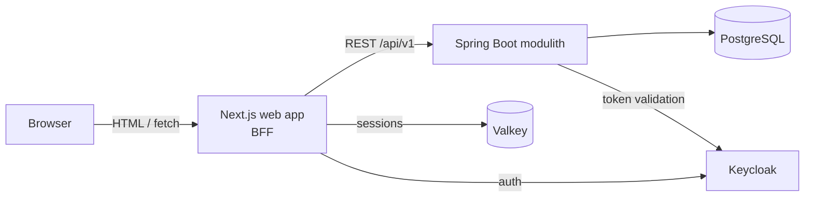

# Kalia

[](https://github.com/MiguelSombrero/kalia/actions/workflows/ci.yml)

> **Status:** iterations 0–8.5 complete — a visitor can browse and search
> the seeded beer catalog end to end (verified: find "Westvleteren" by name,
> filter Belgian quads 9–12 % ABV, open beer details), production-readiness
> foundations (logging, exception handling, config, security headers,
> dependency scanning) are in place, users can sign in and out via Keycloak,
> and a signed-in user can add, edit and remove bottles in their own personal
> beer cellar, grouped by beer with brewed/best-before dates. A user has a
> profile and can make that cellar public: anyone with the link — signed in
> or not — can browse it, and set back to private it leaks nothing, not even
> that it exists. Someone other than the author can sign up for their own
> account with an email address and a password, verify it, and reach their
> own empty cellar, on branded sign-up and sign-in pages in the visitor's own
> language. The front page shows a live feed of what people are adding to
> their public cellars, newest first, updating without a reload (iteration
> 7). Every surface has since been laid out again in an identity the product
> owner picked from prototyped alternatives — "Can art, square" — with
> token-only styling and colour contrast enforced by the build, WCAG 2.2 AA
> checked at lint, unit and end-to-end level, and every page usable at a
> phone and a desktop width (iteration 7.5). The catalog, seeded once from
> Wikidata, now grows: a signed-in user who cannot find a beer adds it, and
> can put a bottle of it in their cellar at once (iteration 8). A quality
> sprint then readied the API for a second client: every error documented
> and typed, what nobody used removed, a beer someone adds seen by others
> only once an operator approves it, and the unauthenticated edges throttled
> (iteration 8.5). Next: an Expo mobile app (iteration 9). Implementation
> proceeds one issue at a time.
> See [docs/roadmap.md](docs/roadmap.md) for what gets built and in which
> order.

## Goal

Kalia is hobby project developed with AI agents, focusing on the development process rather than fast-to-market. The main goals for this project is to:

1. create solid agentic development process which ensures the quality of the product (no drift between documentation and implementation, comprehensive tests etc.)

2. production-grade standards for architecture, design and code.

## Vision

Kalia is a social platform for beer enthusiasts, built around the beer cellar.

Enthusiasts age beer. A cellar is the record of what is down there: which
beers, which bottles, when each was brewed and how long it has left. Kalia
keeps that record, and makes it something you can share.

Three things carry the product:

- **The cellar** — the reason Kalia exists. A cellar holds _bottles_, not just
  beers: an AleSmith IPA brewed in January 2026 is a different thing from one
  brewed two years earlier, and a cellar that cannot tell them apart is a list,
  not a cellar. Yours is private until you decide otherwise; a public cellar is
  something anyone can browse.
- **The catalog** — what makes the cellar possible, since you have to find a
  beer before you can own it. It grows the way it has to: new beers appear
  faster than any single source keeps up with, so the people using Kalia add
  them.
- **The feed** — what makes it social. Adding a beer to your cellar is news to
  people who care about beer; the front page is where that shows up, and where
  a public cellar gets found.

And what Kalia deliberately is not. **It is not a beer review platform** —
Untappd and Pint Please do that well and Kalia will not compete with them. A
rating is a number Kalia _shows_, sourced from elsewhere, never one it collects.
**It is not a beer shop** either; at most, some distant day, it may tell you
where a beer can be bought and for how much.

## Roles

**MiguelSombrero — product owner.** Sets vision and goals, owns every
architecture and design decision, prioritises and refines the backlog, reviews
code and merges pull requests. Does not write code.

**AI agents** produce all documentation and code, in four roles:

- **Scrum master** — proposes iterations, distils the vision into scope, writes
  task files and drives the refinement conversation. Never moves a task to
  `refined` on its own behalf; that transition is the product owner's gate.
- **Architect** — designs module boundaries and data models, proposes ADRs,
  keeps [docs/architecture.md](docs/architecture.md) true. Lays out the
  trade-offs and guides the product owner through them; the product owner
  decides.
- **Developer** — implements one refined task at a time, test-first, and opens
  the pull request.
- **Reviewer** — runs the code-review gate on every diff and the periodic
  quality sweep, and treats review comments as a dialogue, not instructions.

## Run locally

Create a `.env` file at the repository root first — Docker Compose loads it
automatically, and the compose files have no default for this one value on
purpose, since it is a credential:

```bash
echo "KALIA_WEB_CLIENT_SECRET=kalia-dev-secret" > .env
docker compose up --build   # web app at http://localhost:3000
```

The web app is at `:3000`; the backend is also reachable, at `:8080`, for
direct API access and Swagger UI — see [backend/README.md](backend/README.md).
Keycloak's admin console is at `:8081` (admin/admin, dev-only credentials).
Those three are not published by their own containers but by the `edge` nginx
proxy in front of them, which limits requests and body sizes per client
address ([ADR-0090](docs/adr/0090-an-nginx-edge-proxy-bounds-the-anonymous-edges-and-names-the-client-address-the-services-trust.md)),
so a script that floods one gets `429`. Valkey is at `:6379` (password
`kalia-dev-valkey-password`), Postgres at
`:5432`, and Mailpit's inbox UI — where every email Keycloak sends locally
lands — at `:8025`. All bindings are localhost-only, never reachable beyond
the dev machine.

Those are the defaults, and the main checkout keeps them. Each of the six is
a variable in the root `.env` (`WEB_PORT`, `BACKEND_PORT`,
`KEYCLOAK_PORT`, `POSTGRES_PORT`, `VALKEY_PORT`, `MAILPIT_PORT`), and every
address built from one — Keycloak's public address and the issuer the
web app and backend validate, the web app's own URL, the Swagger redirect
URI in the realm — follows it, so changing a port is a one-line edit. A
git worktree is given its own set by `make
stack-env`, which appends them to that worktree's `.env`: slot *n* adds 100×*n*
to each default (slot 1 is the web app `:3100`, backend `:8180`, Keycloak `:8181`,
Postgres `:5532`, Valkey `:6479`, Mailpit `:8125`), taking the lowest slot no
other worktree's `.env` holds and whose ports are free, and re-running it
keeps what it wrote. Two worktrees can then run the stack, `make verify` and
the e2e suite at once. Cookies are scoped to a host and not a port, so two
stacks on `localhost` share their session cookies in one browser; to check
two by hand, give each worktree its own browser profile. The e2e suite is
unaffected, as Playwright's browser contexts are isolated. Running the apps
natively (`npm run dev`, `mvn spring-boot:run`) keeps the defaults and stays
one at a time.
[keycloak/realm-export.json](keycloak/realm-export.json) carries no
credential — the `kalia-web` client secret above and the other dev values
in [docker-compose.dev.env](docker-compose.dev.env) (`POSTGRES_PASSWORD`,
`AUTH_SECRET`, `VALKEY_PASSWORD`, the Keycloak admin login and the rest) are
fixed dev-only values — never reuse them outside local development. The realm
file is applied to Keycloak by the
`keycloak-config` service (`keycloak-config-cli`,
[ADR-0054](docs/adr/0054-keycloak-config-cli-realm-management.md)) on every
startup, not baked into the Keycloak image — it fully reconciles the realm
each run, so a change made in the admin console is overwritten on the next
`docker compose up`. `make verify` fails if the running realm has drifted
from the file; re-apply with `docker compose run --rm keycloak-config`.
To sign in to Kalia itself (not
the Keycloak admin console), use the seeded dev account `testuser` /
`testuser123`, created idempotently on every startup by the `keycloak-seed`
service rather than baked into the realm export. The `kalia-swagger` client Swagger UI
signs in with is a second realm file, [keycloak/realm-swagger.json](keycloak/realm-swagger.json),
that only the local stack imports. For development with hot
reload, run the apps natively — see [backend/README.md](backend/README.md)
and [web/README.md](web/README.md).

## What Kalia does

In roadmap order, a user can:

- Browse craft beers, searching by name and filtering by style, the brewery's country, and alcohol content (ABV) — no account needed
- Use Kalia in English or Finnish (`/en`, `/fi`; auto-detected on first visit, switchable anytime)
- View beer details (brewery, country, style, ABV)
- Sign in with Keycloak
- Maintain a personal beer cellar: the bottles they own, each with its brewed
  and best-before dates, grouped by beer _(iteration 5)_
- Set up a profile and make their cellar public — browsable by anyone with the
  link, signed in or not _(iteration 6)_
- Sign up for an account without the product owner creating it by hand
  _(iteration 6.5)_
- See a live front-page feed of what people are adding to their public
  cellars, updating without a reload _(iteration 7)_
- Use all of it in Kalia's own visual identity, at a phone or a desktop
  width _(iteration 7.5)_
- Add a beer the catalog lacks, from a search that found nothing, and put a
  bottle of it in their cellar at once _(iteration 8)_
- Have the beers and breweries they add reviewed by an operator before anyone
  else sees them, while keeping them in their own cellar from the start
  _(iteration 8.5)_

Then:

- Use Kalia as a native mobile app, which becomes its primary UI: an Expo app
  that signs in and shows real data _(iteration 9)_, runs on the product
  owner's own iPhone _(iteration 10)_, has a design of its own, proven on the
  catalog _(iteration 11)_, holds the cellar readable with no signal
  _(iteration 12)_, brings the feed, profiles and public cellars _(iteration
  13)_, and scans a bottle's barcode to put its beer in the cellar _(iteration
  14)_

Further out, in the [backlog](docs/tasks/backlog.md): beer ratings sourced from
an external platform, likes and comments on feed events, and — dependent on
whether beer shops publish usable APIs — showing where a beer can be bought.

## Architecture

Kalia is a **monorepo** with a Next.js web app and a Spring Boot **modulith**
backend. The web app follows the **backend-for-frontend (BFF)** pattern: the
browser talks only to Next.js, and the Next.js server calls the Spring Boot
REST API. Auth tokens and sessions stay server-side.



The backend is a single deployable split into Spring Modulith modules —
listed in [docs/architecture.md §3](docs/architecture.md#3-backend-modules) —
with enforced boundaries, keeping a later extraction
to microservices possible without paying the distributed-systems cost now.

Full design: [docs/architecture.md](docs/architecture.md) ·
Decision records: [docs/adr/](docs/adr/)

## Tech stack

What this project is built with, and why — an inventory, not a version list.
**The version of a thing lives in the file that installs it** and nowhere
else: `backend/pom.xml`, `web/package.json`, the `docker-compose*.yml` files, the
`Dockerfile`s and `.github/workflows/`
([ADR-0020](docs/adr/0020-documentation-roles.md)'s one-home rule, amended
2026-09-11). A number appears below only where the number is the point of the
sentence — a major version that tells you which framework generation this is,
an override and the condition for removing it, a pin taken to clear a CVE.
Add a technology here when you add it to a manifest; don't restate what the
manifest already says.

### Backend

- Java 25, Spring Boot 4 with Spring Modulith (later possibility to migrate to microservices)
- PostgreSQL 18 (data persistence), Flyway (migrations & seed data)
- Maven (build), JUnit 6 + Testcontainers + Spring Modulith verification tests;
  surefire/failsafe (Spring Boot-managed defaults; unit `*Test` /
  integration `*IT` split), JaCoCo (merged coverage report), ArchUnit
  (package-structure rules)
- Lombok (boilerplate reduction, version managed by Spring Boot's dependency
  BOM — see backend/README.md conventions)
- springdoc-openapi (OpenAPI spec + Swagger UI)
- spring-boot-starter-security-oauth2-resource-server (JWT validation against
  Keycloak, version managed by Spring Boot's dependency BOM — see ADR-0028)
- Micrometer (Prometheus registry and tracing bridge — failure counters and a
  W3C trace id in the logs, no exporter and no viewer; see ADR-0088)
- `pom.xml` overrides Tomcat and the two Jackson BOMs (the 2.x and 3.x lines)
  past the versions the Spring Boot BOM ships, each to clear a CVE. Each
  override carries an XML comment naming the CVE and the condition for
  dropping it again

### Web app

- Next.js 16 (App Router), React 19, TypeScript 5 (TS 7 not yet supported by
  the Next toolchain — revisit when it is)
- Tailwind CSS 4 (styling)
- @radix-ui/react-dialog and @radix-ui/react-toast (headless primitives behind
  the modal and the toast, the only two UI dependencies — why, in ADR-0021)
- TanStack Query (client-component data layer — see ADR-0008)
- Zustand (client UI state — see ADR-0009)
- react-hook-form + Zod (+ @hookform/resolvers) for stateful forms and
  validation (ADR-0010)
- i18next + i18next-resources-to-backend (server-side localization, English +
  Finnish), react-i18next (the client-component bridge, mounted in
  `app/providers.tsx` — see ADR-0011)
- orval (API client generated from the backend's OpenAPI spec, committed + CI
  drift check — see ADR-0012)
- Vitest + React Testing Library (unit/component tests), Playwright (E2E,
  chromium only, against the docker compose stack)
- `package.json` `overrides` pin `postcss` and `sharp` — the one place a
  number below is load-bearing, since JSON takes no comments: next 16.3.1 (as
  published) bundled vulnerable versions of both and npm could not resolve a
  fix inside next's own dependency range. The removal condition is worth
  re-testing on every `next` bump — drop each override once `npm audit` stays
  clean without it (the same `js-yaml`
  override was dropped once orval bundled the fix itself)
- eslint-plugin-jsx-a11y, jest-axe (+ @types/jest-axe), @axe-core/playwright —
  WCAG 2.2 AA enforcement at lint/unit/E2E time (ADR-0075)
- eslint-plugin-boundaries (import boundaries between `app/`, `features/`,
  `components/ui/` and `lib/`, checked by `npm run lint` — see ADR-0012)
- next-auth 5, still a beta line (Auth.js — OIDC Authorization Code + PKCE
  client and session strategy, backed by a custom Valkey adapter — see
  ADR-0025)
- ioredis (Valkey client used by the Auth.js adapter)
- jose (verifies Keycloak's back-channel logout token against the realm's keys
  and reads the session id out of the id token — ADR-0031)
- Valkey (server-side session store, Redis-API-compatible — ADR-0025)
- @prometheus-io/client (the failure counters behind the token-gated
  `/api/metrics` — ADR-0088)

### Local infrastructure

- Keycloak 26 (identity provider — OIDC for the web app, JWT issuer for the
  backend; built from `keycloak/Dockerfile`, which is also where the Kalia
  login theme is baked in — [ADR-0056](docs/adr/0056-branded-bilingual-keycloak-pages.md))
- keycloak-config-cli (`quay.io/adorsys/keycloak-config-cli`, the
  `keycloak-config` service) — reconciles `keycloak/realm-export.json` into
  the running realm on every startup, and `make verify` fails if the realm has
  drifted from it ([ADR-0054](docs/adr/0054-keycloak-config-cli-realm-management.md))
- Mailpit (`axllent/mailpit`) — catches
  every email Keycloak sends in local dev and test; no auth, no real
  delivery. A deployment instead points the realm's SMTP config
  (`docker-compose.base.yml`'s `KEYCLOAK_SMTP_*`) at Gmail SMTP — the choice and its
  limits are in
  [docs/tasks/iteration-6.5/04-send-email-from-kalia.md](docs/tasks/iteration-6.5/04-send-email-from-kalia.md).
  The real credential is not created or held anywhere yet
- nginx (`edge/`, the `edge` service) — the one published service: it
  limits requests and body sizes per client address in front of the web app,
  backend and Keycloak ([ADR-0090](docs/adr/0090-an-nginx-edge-proxy-bounds-the-anonymous-edges-and-names-the-client-address-the-services-trust.md))
- Docker Compose: full stack (edge + PostgreSQL + backend + web app +
  Keycloak + Valkey + Mailpit)
- Base images: Maven and Eclipse Temurin (backend), Node on Alpine (web app);
  tags are in each `Dockerfile`

### CI

- GitHub Actions (`make verify`'s checks, on every push to any branch). Every action is
  SHA-pinned with its tag in a trailing comment — `.github/workflows/` is the
  list; `pr-body.yml` also checks that a
  task-completing pull request fills in the template's Gates section

## Repository layout

```
kalia/
├── backend/          # Spring Boot modulith
│   └── src/main/java/fi/kalia/
│       ├── catalog/  # beers, breweries, search
│       ├── identity/ # token validation, current-user resolution
│       ├── cellar/   # personal beer cellar
│       ├── profile/  # user profile, public cellar visibility
│       └── feed/     # front-page activity feed
├── web/              # Next.js app (BFF + UI), an npm workspace
├── keycloak/         # realm export, login theme, image
├── edge/             # nginx proxy in front of the web app, backend and Keycloak
├── postgres/         # init scripts
├── package.json      # the npm workspaces (ADR-0092)
├── package-lock.json # the one lockfile, for every workspace
├── scripts/          # dependency-free checkers CI runs, git hooks, generators
├── docs/
│   ├── architecture.md
│   ├── roadmap.md
│   ├── glossary.md   # the ubiquitous language
│   ├── tasks/        # per-iteration task lists, backlog, quality backlog
│   └── adr/          # architecture decision records
├── .claude/          # agent skills, rules and settings
├── .github/          # CI workflows, Dependabot
├── Makefile          # `make help`; `make verify-fast` is the local gate
├── docker-compose.yml           # the local stack: includes the base with the dev values
├── docker-compose.override.yml  # what only development has: seed account, Swagger client
├── docker-compose.dev.env       # a dev value for every secret the base requires
└── docker-compose.base.yml      # the deployable definition: requires every secret
```

## The deployable definition

`docker-compose.base.yml` is the definition a deployment runs, and it differs
from the local stack in one way that matters: it has no default for any
secret. Name it alone, and Compose refuses to start with the variable that is
missing:

```bash
docker compose -f docker-compose.base.yml up
# required variable POSTGRES_PASSWORD is missing a value: set POSTGRES_PASSWORD, see README.md
```

It needs `POSTGRES_PASSWORD`, `FEED_CURSOR_KEY`, `AUTH_SECRET`,
`KALIA_WEB_CLIENT_SECRET`, `KEYCLOAK_ADMIN`, `KEYCLOAK_ADMIN_PASSWORD`,
`KEYCLOAK_SSL_REQUIRED` (`none`, `external` or `all`) and `VALKEY_PASSWORD`
(letters, digits and `. _ ~ -` only: it is carried in the session store's address), from the
environment or a `.env`. `METRICS_TOKEN` is optional. It has no seeded account
and no Swagger client, and the web app refuses to start on the dev
`AUTH_SECRET`. A bare `docker compose` is the local stack, so name the file;
[ADR-0089](docs/adr/0089-a-deployment-cannot-inherit-a-dev-credential-because-the-base-compose-file-demands-every-secret.md)
says why it is split this way. `make compose-check` proves the refusal for
each variable.

## Development approach

- **Iterative:** features land as small, end-to-end vertical slices
  (see [roadmap](docs/roadmap.md)) — the catalog first, because it is what the
  cellar is built on, then the cellar, then what makes it social.
- **Test-driven:** tests are written with (or before) the code — unit tests
  for domain logic, Testcontainers-backed integration tests for APIs and
  persistence, Playwright for critical user flows.
- **One issue at a time:** each roadmap task is a small, independently
  reviewable change with tests and updated docs.
- **Checks run locally, not in CI first:** `make verify-fast` is the ~10 s
  local gate and `make install-hooks` puts it behind `git push`; the
  Docker-backed checks are the required CI checks, which block a merge when
  red. `make verify` runs the same list locally, minus the image vulnerability
  scans (and needs [Trivy](https://trivy.dev) installed)
  ([ADR-0046](docs/adr/0046-edit-time-checks-and-one-verify-gate.md)).
  Nothing invokes an AI agent on your behalf at push time. To hand a failure
  to one deliberately, run it yourself:

  ```bash
  claude -p "Run 'make verify-fast', fix every failure it reports, and re-run until it is green. Do not change behaviour." --allowedTools "Edit,Read,Bash"
  ```

## License

See [LICENSE](LICENSE).

## Credits

Kalia's beer catalog includes facts — names, ABVs, styles, and breweries'
countries and cities — imported once from [Wikidata](https://www.wikidata.org/),
whose structured data is available under
[CC0](https://creativecommons.org/publicdomain/zero/1.0/). Kalia credits it
even though CC0 does not require it
([ADR-0077](docs/adr/0077-the-catalog-is-seeded-once-from-wikidata-and-owned-by-kalia.md)).
