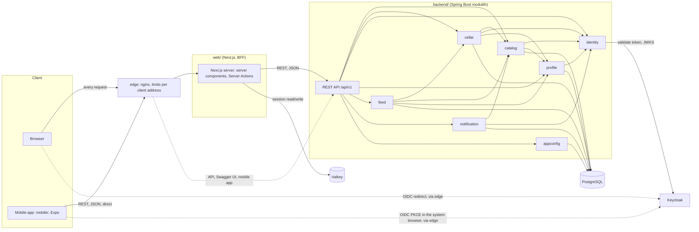

# Kalia — Architecture

*Last updated: 2026-11-07. The shape of what is built, nothing beyond it.
Behaviour is in the READMEs, reasons are in the ADRs, and what comes next is
in [docs/roadmap.md](roadmap.md) ([ADR-0020](adr/0020-documentation-roles.md)). It changes when the
shape changes, and stays under 500 lines.*

## 1. Context and goals

Kalia is a social platform for beer enthusiasts built around the beer cellar:
find a beer, record the bottles you own, see what others keep
([vision](../README.md)). Agents write all the code; the product owner decides
and reviews. The design optimizes for **architectural clarity, testability and
iterative delivery** over scale.

### Functional requirements

What each iteration built: [docs/roadmap.md](roadmap.md#what-each-iteration-built).

### Non-functional requirements

| Concern | Stance |
|---|---|
| Scale | One instance of each service; nothing prevents scaling out |
| Availability | Best effort |
| Latency | Catalog reads under 300 ms p95 at 20 concurrent, on indexes alone, no cache ([ADR-0078](adr/0078-catalog-reads-over-budget-for-want-of-an-index-stay-uncached.md), [ADR-0087](adr/0087-the-brewery-list-is-cut-in-sql-by-a-stored-key-in-the-java-name-order.md), [ADR-0042](adr/0042-bounded-request-parameters.md)) |
| Security | No secrets in the browser; the backend denies by default and validates tokens itself ([§6](#6-authentication-and-identity)) |
| Compliance | GDPR and alcohol rules are out of scope, kept in the [backlog](tasks/backlog.md) |
| Cost / team | Solo developer; no paid service anywhere |

## 2. High-level design



- **BFF for the web app:** the browser never calls Spring; tokens stay
  server-side ([ADR-0003](adr/0003-bff-pattern.md)).
- **The mobile app calls the API directly** through the edge, as a public PKCE
  client ([ADR-0095](adr/0095-the-mobile-app-signs-in-as-a-public-pkce-client-holds-an-offline-token-and-calls-spring-directly-through-the-edge.md)); it is an Expo development build
  ([ADR-0094](adr/0094-the-mobile-app-is-expo-as-a-development-build-with-generated-native-projects-and-no-paid-service.md)), run on a phone over the owner's tailnet
  ([ADR-0097](adr/0097-a-phone-reaches-the-stack-over-the-owners-tailnet-in-an-opt-in-phone-mode-where-one-origin-is-the-issuer.md)).
- **Modulith:** one deployable, one database, module boundaries verified
  ([ADR-0002](adr/0002-spring-modulith.md)).
- **Anonymous browsing, authenticated personal features**; auth came before
  the cellar ([ADR-0006](adr/0006-cellar-first.md)).
- **Polling, no persistent connection** anywhere in the stack
  ([ADR-0060](adr/0060-feed-delivery-is-polling.md)).
- **One trace id, JSON logs and counters, no viewer**
  ([ADR-0088](adr/0088-both-tiers-log-json-and-share-a-trace-id-and-count-failures-without-a-viewer.md)).
- **Only the edge proxy is published by the deployable stack**, with
  per-address limits; the dev overlay also publishes Postgres, Valkey, Mailpit
  and Keycloak's admin console on loopback
  ([ADR-0090](adr/0090-an-nginx-edge-proxy-bounds-the-anonymous-edges-and-names-the-client-address-the-services-trust.md)).

Repository layout, plain npm workspaces ([ADR-0092](adr/0092-the-repository-is-plain-npm-workspaces-of-web-mobile-and-two-packages-that-ship-typescript-source.md)): the tree is in the
[README](../README.md#repository-layout).

Neither app depends on the other, and a package imports from neither.

## 3. Backend modules

Base package `fi.kalia`, one Spring Modulith module per subdomain
([ADR-0002](adr/0002-spring-modulith.md)).

- **Layers inside a module:** `domain`, `application`, `web`, dependencies
  pointing web → application → domain, enforced by ArchUnit and Modulith
  ([ADR-0007](adr/0007-backend-package-structure.md)). What goes in each: [backend/README.md](../backend/README.md).
- **The module's root package is its API** to other modules and calls only its
  own `application` layer.
- **Writes cross modules as events** registered on the aggregate root
  ([ADR-0053](adr/0053-cellar-domain-events-on-the-aggregate-root.md)); **reads** go through the root-package API.
- **`fi.kalia.web` is the one module-neutral exception:** shared exception
  advice and error types ([ADR-0014](adr/0014-shared-exception-handling.md)).

| Module | Responsibility | Depends on |
|---|---|---|
| `catalog` | Beers, breweries, styles; search; user-suggested beers and an admin's review of them | `identity` (current user), `profile` (read: contributor's username) |
| `identity` | Security filter chain, token validation, current user from `sub` | — |
| `cellar` | A user's owned bottles grouped by beer; a public cellar read | `catalog` (read: beer details), `identity` (current user), `profile` (read: visibility) |
| `profile` | Who a user is to others: a username and whether their cellar is public | `identity` (current user) |
| `appconfig` | What the server tells an installed app: minimum build, maintenance flag | — |
| `feed` | A record of acts, today a bottle added, read live on the front page | `cellar` (event: bottle added), `catalog` (read: beer), `profile` (read: username, visibility) |
| `notification` | What a user is told and has not acknowledged: a suggestion's review outcome | `catalog` (event: suggestion reviewed), `identity` (current user) |

Each module's terms: [docs/glossary.md](glossary.md).

### Persistence

- **One schema per module**, no cross-schema foreign keys, references by id.
- **Rich JPA entities;** an aggregate is written only through its root
  ([ADR-0052](adr/0052-cellar-aggregate-owns-its-writes.md)).
- **Flyway owns the schema**, and the connection role cannot change it
  ([ADR-0100](adr/0100-postgres-has-three-roles-one-that-owns-the-schema-for-flyway-one-that-reads-and-writes-rows-and-one-for-keycloak.md)).
- **The catalog ships as migrations**, seeded once from Wikidata
  ([ADR-0077](adr/0077-the-catalog-is-seeded-once-from-wikidata-and-owned-by-kalia.md)); how to regenerate it is in [backend/README.md](../backend/README.md#database-migrations).
- **Events use Modulith's JDBC registry;** delivery is at least once, with
  incomplete publications resubmitted ([ADR-0081](adr/0081-incomplete-event-publications-are-resubmitted-five-times-and-completed-ones-deleted.md)). **Every listener must be idempotent:** a duplicate
  delivery that is not absorbed corrupts data without an error.

### Data model sketch

```
catalog.brewery(id, name, country_code, city, source, wikidata_qid, contributor_id, moderation_status, created_at) — unique (fold_name(name), country_code) over pending and approved rows, unique (wikidata_qid)
catalog.beer(id, brewery_id, name, style, abv, source, wikidata_qid, contributor_id, moderation_status, created_at) — unique (brewery_id, fold_name(name)) over pending and approved rows, unique (wikidata_qid)
cellar.entry(id, user_id, beer_id, version, created_at, updated_at) — unique (user_id, beer_id)
cellar.bottle(id, entry_id, container_type, brewed_date, best_before_date, created_at, updated_at)
profile.profile(id, username, cellar_public, created_at, updated_at) — unique (lower(username))
appconfig.app_config(id, minimum_build_ios, minimum_build_android, maintenance) — one row
feed.line(id, event_id, user_id, beer_id, quantity, brewed_date, occurred_at, sequence_number, ...)
notification.notification(id, event_id, recipient_id, outcome, ...) — deleted when acknowledged
```

### Domain invariants

- **A catalog beer is never deleted;** hiding is a state, so what points at it
  keeps resolving ([ADR-0091](adr/0091-a-contributed-catalog-entry-waits-for-an-operator-and-no-catalog-row-is-ever-deleted.md)).
- **A contributed row is `PENDING` until an admin decides,** in one `catalog`
  transaction that publishes one event ([ADR-0102](adr/0102-a-suggestion-is-a-pending-beer-with-its-new-brewery-and-an-admin-reviews-it-inside-catalog-which-publishes-one-event-per-decision.md)).
- **Every catalog row records its source;** provenance lives in the schema
  ([ADR-0077](adr/0077-the-catalog-is-seeded-once-from-wikidata-and-owned-by-kalia.md)).
- **A brewery's country is an ISO 3166-1 code,** named in the reader's language
  at runtime ([ADR-0079](adr/0079-a-brewerys-country-is-an-iso-code-named-in-the-readers-language-by-the-runtime.md)).
- **The cellar is entry → bottles;** quantity is a count, never a column
  ([ADR-0034](adr/0034-cellar-two-level-bottle-model.md)).
- **A profile is keyed by `sub`, created lazily, and a missing row reads as
  private;** a username is never reused ([ADR-0049](adr/0049-profile-module-and-public-identity.md), [ADR-0080](adr/0080-a-username-is-unique-regardless-of-case-and-never-reused.md)).
- **A feed line is a frozen record of an act,** filtered for visibility when
  read ([ADR-0058](adr/0058-feed-event-recording-model.md), [ADR-0059](adr/0059-feed-respects-cellar-visibility.md)).
- **A get-or-create race retries once** on the unique constraint
  ([ADR-0057](adr/0057-retry-on-constraint-violation-for-get-or-create.md)).
- **A cellar read is joined with its beers in the backend**
  ([ADR-0083](adr/0083-a-cellar-read-is-joined-with-its-beers-in-the-backend.md)).
- **Every domain timestamp reads the application's one `Clock`.**

## 4. API design

Source of truth: `backend/openapi.json` and Swagger UI. Reasons:
[ADR-0042](adr/0042-bounded-request-parameters.md), [ADR-0050](adr/0050-public-cellar-addressing.md),
[ADR-0059](adr/0059-feed-respects-cellar-visibility.md),
[ADR-0060](adr/0060-feed-delivery-is-polling.md), [ADR-0083](adr/0083-a-cellar-read-is-joined-with-its-beers-in-the-backend.md).

- **Two callers, one API:** the web app's BFF calls it from the server with a
  session's token, and the mobile app calls it directly through the edge with
  its own ([§2](#2-high-level-design)). So a resource is **client-agnostic**:
  shaped for the resource, not for the screen that reads it, because a change
  one caller asked for reaches the other. Each endpoint has to stand on its own
  bearer token, and an installed app cannot be updated at the API's pace, hence
  the additive-only rule below.
- **REST JSON under `/api/v1`.**
- **Pages** carry `content`, `totalElements`, `totalPages`, `page`, with
  bounded `size` and `page` ([ADR-0042](adr/0042-bounded-request-parameters.md)). **The feed is the
  exception:** a cursor, not a page number ([ADR-0060](adr/0060-feed-delivery-is-polling.md)).
- **Default-deny bearer auth;** a path whose user is implied by the credential
  is top-level (`/cellar`). The public routes are listed in [§6](#6-authentication-and-identity).
- **Errors are RFC 9457 `problem+json`,** every one, filter chain included
  ([ADR-0014](adr/0014-shared-exception-handling.md)).
- **DTOs at the boundary;** a JPA entity is never serialized, which
  `HttpBoundaryTest` enforces.
- **Another user's resource answers `404`, never `403`.**
- **The spec is committed** and the API changes additively only while an app
  is installed beyond the product owner's own phone ([ADR-0093](adr/0093-the-api-is-additive-only-while-an-app-is-installed-and-a-committed-spec-fails-a-breaking-diff.md)).
- **A breaking change is a new path** beside a `deprecated` one, removed only
  once `app-config`'s minimum build excludes every user of it.
- **`CommittedOpenApiSpecIT`** fails a stale spec, and **`make api-breaking`**
  reports a breaking diff, failing on one only once the app is distributed.

## 5. Client design

Both clients call the same API and share `packages/`; each README holds its
day-to-day rules ([web/README.md](../web/README.md),
[mobile/README.md](../mobile/README.md)).

### The web app

- **App Router, server components by default;** a client component only where
  the browser is needed, and only client components use TanStack Query
  ([ADR-0008](adr/0008-tanstack-query.md)).
- **`features/<feature>/` owns its components, hooks and API access;** `app/`
  stays thin, and ESLint enforces the layers ([ADR-0012](adr/0012-orval-api-client.md), amended 2026-08-15).
- **Server components and Server Actions call the backend;** a client
  component reads authenticated data through a Server Action
  ([ADR-0040](adr/0040-client-reads-via-server-actions.md)).
- **State has three homes:** server data in TanStack Query behind feature
  hooks, navigational state in the URL, ephemeral UI state in Zustand
  ([ADR-0008](adr/0008-tanstack-query.md), [ADR-0009](adr/0009-zustand-ui-state.md), [ADR-0041](adr/0041-tanstack-query-feature-owned-hooks.md)).
- **The API client is generated** from the committed spec into `@kalia/api`,
  wrapped by each feature ([ADR-0012](adr/0012-orval-api-client.md)).
- **English and Finnish with locale-prefixed URLs** ([ADR-0011](adr/0011-i18next-localization.md));
  Keycloak's pages are translated by Keycloak ([ADR-0056](adr/0056-branded-bilingual-keycloak-pages.md)).
- **Token-driven styling,** one set of primitives, no component library
  ([ADR-0021](adr/0021-design-tokens-ui-primitives.md), [ADR-0073](adr/0073-components-ui-stays-the-apps-own-primitives-not-a-design-system.md)); intent is in
  [docs/design.md](design.md).
- **Loading, error and empty states have one standard shape**
  ([ADR-0022](adr/0022-loading-error-empty-states.md)).
- **WCAG 2.2 AA** ([ADR-0075](adr/0075-the-accessibility-bar-is-wcag-2-2-aa.md)).

### The mobile app

- **Expo Router,** a development build, with `ios/` and `android/` generated
  and never committed ([ADR-0094](adr/0094-the-mobile-app-is-expo-as-a-development-build-with-generated-native-projects-and-no-paid-service.md)).
- **The web's conventions carry over** where they are not about the browser
  ([ADR-0094](adr/0094-the-mobile-app-is-expo-as-a-development-build-with-generated-native-projects-and-no-paid-service.md)); ESLint enforces the layers and the generated client's isolation
  ([ADR-0012](adr/0012-orval-api-client.md)).
- **The app signs in as a public PKCE client** and holds an offline token
  ([ADR-0095](adr/0095-the-mobile-app-signs-in-as-a-public-pkce-client-holds-an-offline-token-and-calls-spring-directly-through-the-edge.md)).
- **A launch check asks `GET /api/v1/app-config`** and blocks an outdated build
  or a server in maintenance ([ADR-0093](adr/0093-the-api-is-additive-only-while-an-app-is-installed-and-a-committed-spec-fails-a-breaking-diff.md)).
- **Errors are read from the device's own logs;** no crash service
  ([ADR-0098](adr/0098-an-installed-builds-errors-are-read-from-the-devices-own-logs-and-a-crash-service-waits-for-a-second-user.md)).
- **WCAG 2.2 AA** in platform terms ([ADR-0075](adr/0075-the-accessibility-bar-is-wcag-2-2-aa.md)).

## 6. Authentication and identity

- **Web:** Keycloak OIDC with PKCE, handled by Auth.js in the BFF, sessions in
  Valkey ([ADR-0025](adr/0025-authjs-valkey-adapter.md)).
- **Mobile:** a second public Keycloak client, `kalia-mobile`, an offline
  token, no BFF ([ADR-0095](adr/0095-the-mobile-app-signs-in-as-a-public-pkce-client-holds-an-offline-token-and-calls-spring-directly-through-the-edge.md)).
- **The backend is an OAuth2 resource server:** `sub` is the user key, and
  `identity` is the only module that reads a token's claims
  ([ADR-0028](adr/0028-resource-server-and-current-user.md)).
- **An admin is a realm role** enforced on `/api/v1/admin/**` and read by the
  web's BFF; the mobile app's token never carries it ([ADR-0101](adr/0101-an-admin-is-a-realm-role-in-the-access-token-which-the-backend-enforces-on-one-path-prefix-and-the-web-reads-in-its-bff.md)).
- **Keycloak owns** registration, mail, lockout and the branded sign-in pages
  ([ADR-0055](adr/0055-self-registration-via-keycloak.md), [ADR-0056](adr/0056-branded-bilingual-keycloak-pages.md), [ADR-0061](adr/0061-brute-force-lockout-is-temporary-and-disclosed.md)); the realm
  is applied from `keycloak/realm-export.json` ([ADR-0054](adr/0054-keycloak-config-cli-realm-management.md)).
- **A deployment cannot inherit a dev credential:** the base compose file
  demands every secret ([ADR-0089](adr/0089-a-deployment-cannot-inherit-a-dev-credential-because-the-base-compose-file-demands-every-secret.md)).

**These routes alone answer without a token;** a new endpoint is protected
unless it is added here. `SecurityConfig` permits them and `PublicRoutesIT`
fails when the set differs:

- the catalog reads: `GET /api/v1/beers`, `/beers/{id}`, `/breweries`,
  `/breweries/countries`, `/styles`, `/countries`;
- a public cellar, `GET /api/v1/cellars/{username}`
  ([ADR-0050](adr/0050-public-cellar-addressing.md));
- the feed, `GET /api/v1/feed` ([ADR-0059](adr/0059-feed-respects-cellar-visibility.md));
- `GET /api/v1/app-config` ([ADR-0093](adr/0093-the-api-is-additive-only-while-an-app-is-installed-and-a-committed-spec-fails-a-breaking-diff.md));
- the actuator, `/actuator/**`: whatever `ACTUATOR_ENDPOINTS` exposes, `health`
  alone by default; the edge refuses all of it but `health`
  ([ADR-0088](adr/0088-both-tiers-log-json-and-share-a-trace-id-and-count-failures-without-a-viewer.md));
- the API docs where `SPRINGDOC_ENABLED` is on: `/v3/api-docs`,
  `/v3/api-docs/swagger-config`, `/swagger-ui.html`, `/swagger-ui/`.

## 7. Testing strategy

| Layer | Tooling | What |
|---|---|---|
| Backend unit | JUnit | Domain logic, no Spring context |
| Backend integration | Spring Boot Test, Testcontainers | REST, repositories, migrations, events |
| Module and architecture rules | Modulith, ArchUnit | Boundaries, layers, the HTTP boundary; `ArchitectureDocumentationTest` holds §2 and §3 to the code |
| Web unit and component | Vitest, Testing Library, `jest-axe` | Components and BFF handlers, with WCAG checks |
| Mobile unit | Jest, Testing Library | Screens and components, no network ([ADR-0096](adr/0096-mobile-unit-tests-run-on-jest-and-end-to-end-flows-on-maestro-with-android-the-only-ci-platform.md)) |
| Web E2E | Playwright | Critical journeys against the compose stack |
| Mobile E2E | Maestro | A release build against the compose stack ([ADR-0096](adr/0096-mobile-unit-tests-run-on-jest-and-end-to-end-flows-on-maestro-with-android-the-only-ci-platform.md)) |
| Import boundaries and the API contract | ESLint, `make api-drift`, `make api-breaking` | The layers, the generated client, the spec ([ADR-0093](adr/0093-the-api-is-additive-only-while-an-app-is-installed-and-a-committed-spec-fails-a-breaking-diff.md)) |
| Static and security checks | `make check`, Trivy | Docs, tasks, links, tokens; dependencies and images ([ADR-0024](adr/0024-dependency-vulnerability-scanning.md)) |

Test naming and commands: [backend/README.md](../backend/README.md),
[web/README.md](../web/README.md), [mobile/README.md](../mobile/README.md). The
local gate and the CI gate: [ADR-0046](adr/0046-edit-time-checks-and-one-verify-gate.md).

## 8. Trade-offs made explicit

- **Modulith over microservices:** one deployable and one database keep
  operations trivial, at the cost of discipline at boundaries
  ([ADR-0002](adr/0002-spring-modulith.md)).
- **BFF for the web, direct calls for mobile:** an extra hop buys no tokens in
  the browser; a phone has secure storage a browser lacks
  ([ADR-0095](adr/0095-the-mobile-app-signs-in-as-a-public-pkce-client-holds-an-offline-token-and-calls-spring-directly-through-the-edge.md)).
- **A token outlives sign-out by up to its 5-minute lifespan:** the backend
  asks Keycloak nothing per request; introspection would make every write
  depend on Keycloak ([ADR-0095](adr/0095-the-mobile-app-signs-in-as-a-public-pkce-client-holds-an-offline-token-and-calls-spring-directly-through-the-edge.md), [ADR-0101](adr/0101-an-admin-is-a-realm-role-in-the-access-token-which-the-backend-enforces-on-one-path-prefix-and-the-web-reads-in-its-bff.md)).
- **`GET /api/v1/cellar` answers every entry, uncapped:** the offline cache
  needs the whole cellar. Everything else is bounded. Revisit in
  [iteration 12](tasks/iteration-12.md).
- **The catalog is owned and seeded once from Wikidata,** not read live: no
  runtime dependency, at the cost of an ageing snapshot and an accepted
  provenance risk ([ADR-0077](adr/0077-the-catalog-is-seeded-once-from-wikidata-and-owned-by-kalia.md)).
- **Contributions are reviewed and a row is hidden, never deleted:** nothing
  that points at a beer is orphaned ([ADR-0091](adr/0091-a-contributed-catalog-entry-waits-for-an-operator-and-no-catalog-row-is-ever-deleted.md)).
- **No catalog read cache, measured:** indexes keep reads inside the budget, at
  the cost of re-measuring when the catalog's size or queries change
  ([ADR-0078](adr/0078-catalog-reads-over-budget-for-want-of-an-index-stay-uncached.md)); the method is in the ADR's Evidence.
- **Built-in observability and no viewer:** counters are per process and reset
  on restart ([ADR-0088](adr/0088-both-tiers-log-json-and-share-a-trace-id-and-count-failures-without-a-viewer.md)).
- **Single instance, accepted where written down:** a second backend instance
  would reset the first's in-flight event deliveries. Revisit at the first
  multi-instance deployment ([ADR-0081](adr/0081-incomplete-event-publications-are-resubmitted-five-times-and-completed-ones-deleted.md)).

## 9. Architecture decision records

The decisions that define the system. Every ADR, by number, is in
[adr/README.md](adr/README.md#all-adrs-by-number); by subject, in the same file.

- [ADR-0002](adr/0002-spring-modulith.md) — a Spring Modulith, not microservices.
- [ADR-0003](adr/0003-bff-pattern.md) — the web app is a backend for frontend.
- [ADR-0006](adr/0006-cellar-first.md) — the cellar comes first.
- [ADR-0007](adr/0007-backend-package-structure.md) — the backend's package structure.
- [ADR-0014](adr/0014-shared-exception-handling.md) — shared exception handling, `problem+json`.
- [ADR-0020](adr/0020-documentation-roles.md) — what each document records.
- [ADR-0028](adr/0028-resource-server-and-current-user.md) — the backend is a resource server; `sub` is the user.
- [ADR-0034](adr/0034-cellar-two-level-bottle-model.md) — the cellar is entry → bottles.
- [ADR-0060](adr/0060-feed-delivery-is-polling.md) — the feed is delivered by polling.
- [ADR-0077](adr/0077-the-catalog-is-seeded-once-from-wikidata-and-owned-by-kalia.md) — the catalog is seeded once from Wikidata.
- [ADR-0091](adr/0091-a-contributed-catalog-entry-waits-for-an-operator-and-no-catalog-row-is-ever-deleted.md) — a catalog row is hidden, never deleted.
- [ADR-0093](adr/0093-the-api-is-additive-only-while-an-app-is-installed-and-a-committed-spec-fails-a-breaking-diff.md) — the API is additive-only; the spec is committed.
- [ADR-0095](adr/0095-the-mobile-app-signs-in-as-a-public-pkce-client-holds-an-offline-token-and-calls-spring-directly-through-the-edge.md) — the mobile app is a public PKCE client.
- [ADR-0100](adr/0100-postgres-has-three-roles-one-that-owns-the-schema-for-flyway-one-that-reads-and-writes-rows-and-one-for-keycloak.md) — three Postgres roles.
- [ADR-0102](adr/0102-a-suggestion-is-a-pending-beer-with-its-new-brewery-and-an-admin-reviews-it-inside-catalog-which-publishes-one-event-per-decision.md) — a suggestion is a pending beer an admin reviews.
