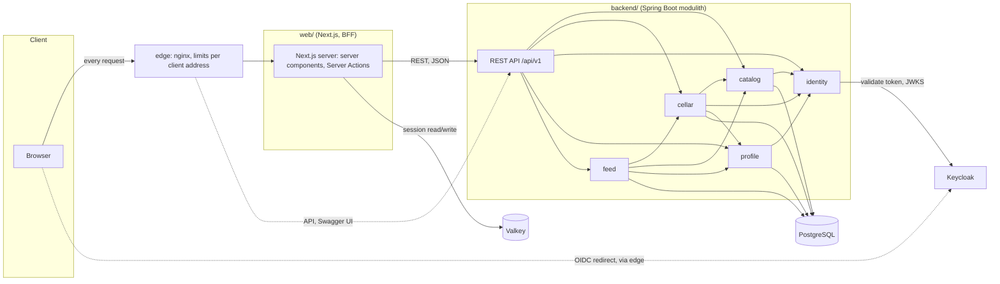

# Kalia — Architecture

*Last updated: 2026-10-31. This document describes **what is built**, plus the
iteration currently being built — nothing beyond it. What might come next lives
in [docs/roadmap.md](roadmap.md) and [docs/tasks/](tasks/); why a shape was
chosen lives in the ADRs ([ADR-0020](adr/0020-documentation-roles.md)). Update
it in the same PR as the change it describes; record significant decisions as
ADRs in [adr/](adr/) and index them in
[§9](#9-architecture-decision-records).*

## 1. Context and goals

Kalia is a social platform for beer enthusiasts built around the beer cellar:
find a beer in the catalog, record the bottles of it you own, and — as the
[vision](../README.md) is built out — share that cellar and see what others are
putting in theirs. The project is developed process-first by AI agents: the
product owner sets vision and goals, owns every architecture and design
decision and reviews; agents implement all documentation and code
([README.md roles](../README.md)). The design optimizes for **architectural
clarity, testability, and iterative delivery** over premature scale.

### Functional requirements

Built:

- Search beers by name, and filter them by style, the brewery's country and
  ABV
- Beer detail view
- Sign-in and sign-out (Keycloak); browsing stays anonymous
- Personal beer cellar: the signed-in user's owned bottles, each carrying its
  own brewed and best-before dates, grouped by the catalog beer they are
  bottles of *(iteration 5)*
- A user profile and a cellar-visibility control; a public cellar readable by
  anyone from a link or the owner's profile *(iteration 6)*
- Self-registration with email verification, so someone other than the author
  can create an account *(iteration 6.5)*
- A front-page activity feed of the bottles people add to their cellars,
  kept current by polling *(iteration 7)*
- A designed visual identity — colour and type tokens, icons, the Kalia mark
  and a layout for every page, the Keycloak pages included *(iteration 7.5)*
- A catalog seeded once from Wikidata, to which a signed-in user adds a beer
  it lacks, and its brewery, with catalog search held within its latency
  budget at 150k beers *(iteration 8)*
- An API a second client can inherit: every error documented and typed, what
  nobody used removed, contributed catalog entries visible to others only once
  an operator approves them and never hard-deleted, the unauthenticated edges
  throttled by an nginx proxy, and a stack that refuses to start as a
  deployment without its secrets *(iteration 8.5)*

No iteration is in progress. The next is [iteration 9](tasks/iteration-9.md),
the mobile foundations; nothing in it is built yet.

### Non-functional requirements

| Concern | Stance |
|---|---|
| Scale | Single instance of each service is fine; design must not *prevent* horizontal scaling |
| Availability | Best effort; no HA requirements |
| Latency | Catalog reads stay under 300 ms p95 server time at 20 concurrent requests on indexes alone, with no caching layer. That holds at the imported size and at a generated 150k: task 18's `(lower(name), id)` index and custom plans for 1–2-character name queries, and a stored sort key and index for the brewery list ([ADR-0087](adr/0087-the-brewery-list-is-cut-in-sql-by-a-stored-key-in-the-java-name-order.md)), brought them within it ([ADR-0078](adr/0078-catalog-reads-over-budget-for-want-of-an-index-stay-uncached.md), Evidence). Deep pages are cut off by a bound on how many rows one page may skip ([ADR-0042](adr/0042-bounded-request-parameters.md)). The question reopens past 150k beers, or when a read no index can serve goes over budget ([§7](#catalog-read-latency)) |
| Security | No secrets in the browser (BFF pattern); standard input validation; the backend denies by default and validates bearer tokens itself ([§6](#6-authentication-and-identity)) |
| Compliance | GDPR and alcohol-related regulation are out of scope for now; carried in the [backlog](tasks/backlog.md) so they aren't forgotten if the project turns real |
| Cost / team | Solo developer; minimize moving parts per iteration |

## 2. High-level design



Key properties:

- **BFF pattern** ([ADR-0003](adr/0003-bff-pattern.md)): the browser never
  calls Spring Boot directly (the dashed edge to the API is Swagger UI and
  other API clients, not the browser app). Server components and Server Actions, running
  in the one Next.js server process, call the backend. Tokens and session state stay server-side; CORS is a
  non-issue.
- **Modulith** ([ADR-0002](adr/0002-spring-modulith.md)): one deployable, one
  database, but hard module boundaries verified by Spring Modulith tests.
- **Anonymous browsing, authenticated personal features**: the catalog needs
  no account; the cellar requires sign-in. Authentication was built before the
  cellar because the cellar is per-user data
  ([ADR-0006](adr/0006-cellar-first.md)).
- **No persistent connection anywhere in the stack.** The one page that
  updates without a reload — the front-page feed — polls on an interval
  through a Server Action rather than holding a stream open; there is no
  server-sent-events or WebSocket endpoint, and no connection registry
  ([ADR-0060](adr/0060-feed-delivery-is-polling.md)).
- **One trace id per browser request, JSON logs and counters, no viewer**
  ([ADR-0088](adr/0088-both-tiers-log-json-and-share-a-trace-id-and-count-failures-without-a-viewer.md)):
  `proxy.ts` starts a W3C `traceparent`, the BFF forwards it on every backend
  call, and both tiers log it in JSON lines. Counters are served by the
  backend at `/actuator/prometheus` and the web app at `/api/metrics`, each
  behind a token. How to read them is in the two READMEs.

**Repository layout** ([ADR-0092](adr/0092-the-repository-is-plain-npm-workspaces-of-web-mobile-and-two-packages-that-ship-typescript-source.md)).
The repository is npm workspaces, with no tool on top.

```text
backend/    Spring Boot modulith
web/        the Next.js app
mobile/     the Expo app
packages/   two packages shipped as TypeScript source: `@kalia/api`, the
            generated API client and its fetch core, and `@kalia/locales`,
            the en/fi strings
package.json, package-lock.json   npm workspaces; the only lockfile
```

npm hoists every workspace's dependencies into one `node_modules/` at the
root. The web's Docker image is built with the repository root as its context
and installs only the web workspace's dependencies (`web/Dockerfile`).

Neither app depends on the other. A package imports from neither, and from
none of `react-dom`, `next` or `react-native`, which a lint rule enforces.

**Mobile client** ([ADR-0094](adr/0094-the-mobile-app-is-expo-as-a-development-build-with-generated-native-projects-and-no-paid-service.md)). `mobile/` is an Expo app built as a
development build, not run in Expo Go, which cannot carry the app's `kalia://`
redirect scheme. Its stack:

- Expo Router for navigation, TypeScript with `strict` on, and plain
  `StyleSheet` until iteration 11 decides the design language.
- `ios/` and `android/` are generated by `expo prebuild` and gitignored;
  `app.json` and config plugins are the source of truth for anything native.
- The web's data, state, form and i18n conventions carry over (TanStack Query
  behind feature hooks, Zustand, react-hook-form with Zod, i18next); the
  browser-only parts of them do not.
- The SDK version lives in `mobile/package.json` alone, and minimum OS versions
  are the SDK's own.
- No paid service is on the build or run path: no EAS builds or updates, so no
  over-the-air updates, and the app is run on the iOS Simulator and the Android
  Emulator.

The diagram above shows the web path only. How the app reaches the API and
authenticates is [task 05](tasks/iteration-9/05-decision-mobile-authentication.md)'s
decision.

## 3. Backend modules

Base package `fi.kalia`, one Spring Modulith module per subdomain — with
one sanctioned exception: `fi.kalia.web` holds shared, module-neutral
exception-handling advice and the error types it answers with, with no
subdomain of its own, which every module may depend on
([ADR-0014](adr/0014-shared-exception-handling.md)). The base package
itself holds only application-wide wiring that belongs to no module: the
entry point, its required-configuration check, event publication
resubmission, and `ApplicationConfig` — method-level resilience
(`@EnableResilientMethods`, which every module's `@Retryable` relies on) and
the application's one `Clock`, in UTC, which the cellar's timestamps and
`BottleAdded`'s `occurredAt` and the feed's 30-day window read rather than the
system time. Inside each
subdomain module, DDD-lite layers as direct subpackages — all
Modulith-internal by default
([ADR-0007](adr/0007-backend-package-structure.md)): `domain` (rich JPA
entities, value objects, repositories), `application` (use-case services),
`web` (controllers, advice, HTTP DTOs and boundary mapping), with dependency
direction **web → application → domain** — enforced by ArchUnit
(`ArchitectureTest`) alongside Spring Modulith's module-boundary verification
(`ModularityTest`). What goes in each layer:
[backend/README.md](../backend/README.md) code conventions.

The module root package is reserved for the **inter-module API** and stays
empty until the module's first consumer arrives. It obeys the same inward
dependency direction as `web` — it calls its module's `application` layer and
never names a `domain` type, so whatever it hands another module is built in
`application`, enforced by `ArchitectureTest`. Full
ports/adapters ceremony is deferred to modules whose domain earns it.
Cross-module *writes* happen via application events — registered on the
aggregate root and drained by Spring Data on `save`, never published from a
service ([ADR-0053](adr/0053-cellar-domain-events-on-the-aggregate-root.md));
cross-module *reads* via the root-package API.

| Module | Responsibility | Depends on |
|---|---|---|
| `catalog` | Beers, breweries, styles; search & filtering; a signed-in user adding a beer, and its brewery, the catalog lacks *(iteration 8)* | `identity` (current user, recorded as a user-added row's contributor) |
| `identity` | Security filter chain, bearer-token validation, current-user resolution from the token's `sub` | — |
| `cellar` | The signed-in user's owned bottles, grouped by catalog beer; a public cellar read for anyone, which `CellarService` itself refuses unless the owner made it public | `catalog` (read: beer existence; name, brewery, style and strength), `identity` (current user), `profile` (read: public-cellar visibility) |
| `profile` | Who a user is to other users: a username copied once from the identity provider, plus whether their cellar is public | `identity` (current user: the caller's id and username, for the caller's own profile) |
| `feed` | A record of things that happened — currently, a bottle added to a cellar, read over HTTP and rendered live on the front page | `cellar` (event: bottle added), `catalog` (read: beer name, brewery, style and strength), `profile` (read: username and current cellar visibility) |

The term each module owns — every `domain` type's meaning inside its module,
the words that mean two things across modules, and the published REST/JSON/
TypeScript vocabulary a client meets — is catalogued in
[docs/glossary.md](glossary.md), kept current by `scripts/check-glossary.mjs`.

### Persistence

- Single PostgreSQL database; **one schema per module** so module boundaries
  are visible in the data layer and a future service extraction has clean
  seams. No cross-schema foreign keys between modules — cross-module references
  are by id only.
- Spring Data JPA with rich domain entities where behavior exists; plain
  records/projections for read models. A non-root entity in an aggregate — a
  `cellar.bottle` under its `entry` — is written only through its root and has
  no repository of its own, enforced by ArchUnit
  ([ADR-0052](adr/0052-cellar-aggregate-owns-its-writes.md)).
- Flyway owns the schema, with migrations per module directory plus `common/`
  for cross-module infrastructure (layout and version-numbering rules:
  [backend/README.md](../backend/README.md) database migrations). The
  catalog's data ships as versioned migrations, so every environment holds the
  same catalog: a hand-written seed (`V004`) and the Wikidata import (`V008`),
  whose size [ADR-0078](adr/0078-catalog-reads-over-budget-for-want-of-an-index-stay-uncached.md)
  measures.
- **The catalog's data source is Kalia itself, seeded once from Wikidata**
  ([ADR-0077](adr/0077-the-catalog-is-seeded-once-from-wikidata-and-owned-by-kalia.md)).
  `V008` is generated, never hand-edited: `scripts/wikidata-migration.mjs`
  builds it from the committed snapshot `scripts/wikidata/snapshot.json`,
  which `scripts/wikidata-extract.mjs` took once, offline. The import's rules
  ([iteration 8 task 17](tasks/iteration-8/17-seed-the-catalog-from-wikidata.md)
  and ADR-0077's amendment) live in the generator, and the mappings it
  applies are committed beside the snapshot: Wikidata's style classes onto
  Kalia's styles (`styles.json`), each seeded row to its Wikidata item
  (`seed-matches.json`), four hand-reviewed brewery countries
  (`brewery-countries.json`), each Wikidata country label to its ISO 3166-1
  code (`country-codes.json`), and the present-day country of each brewery
  whose label names a state with no code (`present-day-countries.json`,
  [ADR-0079](adr/0079-a-brewerys-country-is-an-iso-code-named-in-the-readers-language-by-the-runtime.md)).
  The seed's rows are never changed: an imported
  beer matching one is skipped, and an imported beer of a seeded brewery
  attaches to the seeded row. `make check` fails if the generated migration
  no longer matches the snapshot, or if the snapshot, the migration or the
  schema could carry anything from Untappd. No catalog read ever calls an
  external service.
- One PostgreSQL extension is required: `pg_trgm`, installed into `public` by
  the catalog migrations for the search indexes in the data model below.
- Spring Modulith's event publication registry uses the JDBC flavor (not JPA),
  so framework infrastructure stays out of the persistence unit; its
  `event_publication` table lives in the `public` schema, created by Flyway
  from Modulith's own DDL.
- Delivery through the registry is at-least-once
  ([ADR-0081](adr/0081-incomplete-event-publications-are-resubmitted-five-times-and-completed-ones-deleted.md)).
  `fi.kalia.EventPublicationResubmission` resubmits a publication whose
  listener has not completed: at startup, then on a schedule once its latest
  attempt is old enough. After a capped number of attempts it is logged at
  `ERROR` and left in `event_publication`, which otherwise holds only
  incomplete publications, since a completed one is deleted. The timings and
  the cap are `kalia.events.resubmission.*` in `application.properties`. Every listener must therefore tolerate
  receiving the same event twice.

### Data model sketch

```
catalog.brewery(id, name, country_code, city, source, wikidata_qid, contributor_id, moderation_status, created_at) — unique (fold_name(name), country_code) over pending and approved rows, unique (wikidata_qid)
catalog.beer(id, brewery_id, name, style, abv, source, wikidata_qid, contributor_id, moderation_status, created_at) — unique (brewery_id, fold_name(name)) over pending and approved rows, unique (wikidata_qid)
cellar.entry(id, user_id, beer_id, version, created_at, updated_at) — unique (user_id, beer_id)
cellar.bottle(id, entry_id, container_type, brewed_date, best_before_date, created_at, updated_at)
profile.profile(id, username, cellar_public, created_at, updated_at) — unique (lower(username))
feed.line(id, event_id, user_id, beer_id, quantity, brewed_date, occurred_at, sequence_number, created_at, updated_at)
```

`style` starts as an indexed text column; normalize into its own table only
if style metadata appears. Its vocabulary is the seed's styles extended by the
import's style mapping.

**Every catalog row records where it came from**
([ADR-0077](adr/0077-the-catalog-is-seeded-once-from-wikidata-and-owned-by-kalia.md)).
`source` is `SEED`, `WIKIDATA` or `USER`, and an imported row, and only an
imported one, carries the Wikidata item it came from in `wikidata_qid`.
Provenance lives in the schema alone: `Beer` and `Brewery` do not map either
column, and a row the application inserts is marked `USER` by the column's
default, which `V008` sets once the seed and the import have written theirs. Every
Wikidata-sourced row can therefore be found, or removed, in one statement. A
brewery is unique by its name, with case, whitespace and punctuation folded by
`catalog.fold_name()`, within its country, and a beer by its folded name within
its brewery. Seeded beers and breweries keep the ids `V004` gave them, so
cellar entries that point at them survive the import.

**A brewery's country is its ISO 3166-1 alpha-2 code, and nothing else**
([ADR-0079](adr/0079-a-brewerys-country-is-an-iso-code-named-in-the-readers-language-by-the-runtime.md)).
The API carries it as `countryCode`, and the web app names it in the
reader's language with `Intl.DisplayNames`, on the server. `V004` inserts its
breweries by English name into a column `V003` keeps for them alone; `V008`
gives those rows their codes and drops it.

**A signed-in user can add a beer the catalog lacks**, and its brewery with it
when that is missing too. It is held to the imported catalog's bar: a style the catalog already
has, an ABV, and for a new brewery a country from a fixed list — every
ISO 3166-1 code (`Country`). A user-added row records its contributor (the identity
`sub`) in `contributor_id`, which no read response carries; only a `USER` row
may have one, and it may be cleared while the row stays. Adding a beer or
brewery that the unique indexes above already hold is refused rather than
merged: `ContributionService` looks for the existing row first, and the index
decides a concurrent race, which the losing request's retry turns into the
same refusal ([ADR-0057](adr/0057-retry-on-constraint-violation-for-get-or-create.md)).
`catalog.fold_name()` applies NFKC before it folds case, whitespace and
punctuation, as the Wikidata generator does, so a fullwidth twin of a name is a
duplicate; a name holding a Unicode `Cf` character (zero-width, bidirectional
control, soft hyphen) is refused with `400` before the check can see it.

**A contributed row is reviewed before anyone but its contributor sees it**
([ADR-0091](adr/0091-a-contributed-catalog-entry-waits-for-an-operator-and-no-catalog-row-is-ever-deleted.md)).
`moderation_status` is `PENDING` for a row a user adds and `APPROVED` for every
seeded and imported row; an operator moves a contributor's rows to `APPROVED`,
`REJECTED` or `REMOVED` with `make moderate`
([backend/README.md](../backend/README.md#moderating-contributions)). A pending
row is found, opened and cellared by its contributor alone, and is left out of
search, the brewery list, other users' reads, every public cellar and the feed
until approved. A contributor may have 20 entries waiting (a new brewery counts
as one); an add past that answers `429` `problem+json`. A `REJECTED` or
`REMOVED` row is hidden from search and lists the same way, and is dropped from
the duplicate key so its name can be proposed again.

**A catalog beer is never deleted.** Cellar entries and feed lines point at one
by id across a module boundary with no foreign key, so a deleted beer would
leave entries its owner can no longer see. Hiding is a state, not an absence:
a `REJECTED` or `REMOVED` beer is still named in an owner's cellar and the feed,
but not in a public cellar. `CellarService` and `FeedService` therefore treat a beer
they cannot resolve as a defect (the cellar logs it at `WARN`), except one
that is not `APPROVED`, which a public cellar read withholds on purpose.

Catalog search is served by indexes matching the shape of each filter: a
`pg_trgm` trigram `GIN` index on `lower(beer.name)` for substring matching, and
a functional B-tree index on `lower(beer.style)`, and a B-tree index on
`brewery.country_code` ([ADR-0044](adr/0044-catalog-search-indexes.md)). A
B-tree on `(lower(beer.name), beer.id)` matches the default sort, so a page
reads its rows in order rather than sorting every match. A search whose name
term is 1–2 characters, too short for trigrams, plans each statement for its
own values (`plan_cache_mode = force_custom_plan`, for that transaction only),
so it is never served by the trigram index's generic plan
([ADR-0078](adr/0078-catalog-reads-over-budget-for-want-of-an-index-stay-uncached.md)).

The brewery list and its search are served the same way. `brewery.name_sort_key`
holds each name folded to `String.CASE_INSENSITIVE_ORDER`'s order, in `C`
collation, so a B-tree on `(name_sort_key, id)` reads a page in order whatever
the database's locale. The `Brewery` entity and the Wikidata generator both
write it ([ADR-0087](adr/0087-the-brewery-list-is-cut-in-sql-by-a-stored-key-in-the-java-name-order.md)).
A trigram index on `lower(brewery.name)` serves the search's substring match.

**The cellar is two levels, not one** ([ADR-0034](adr/0034-cellar-two-level-bottle-model.md)).
A catalog beer is a *brand* (AleSmith IPA); what a person owns is a *bottle*
of it, with its own brewed and best-before dates and a container type
(bottle/can/keg). A cellar that collapses those into one row with a quantity
cannot tell a 2026 bottle from a 2024 one, which is the whole point of
cellaring beer. So `cellar` holds one entry per (user, catalog beer), owning
the individual bottles beneath it; quantity is always `COUNT(*)` over those
rows, never a stored column — adding several bottles at once (a purchased
case) is a bulk *operation* that still creates one row per bottle, not a
batch row with a count. `user_id` and `beer_id` are cross-module references
by id only, matching the persistence rule above. Both tables carry
`created_at` and `updated_at`, the convention this module sets going forward;
`catalog.beer` predates it and has only `created_at`. A bottle is removed by
deleting its row — there is no "drunk" state yet. An entry is a pure grouping,
not something a user keeps: it is deleted when its last bottle is removed, so
the cellar holds exactly the beers you own bottles of and no reader ever sees
a zero-quantity row. Re-adding that beer creates a fresh entry
([ADR-0034](adr/0034-cellar-two-level-bottle-model.md)).

**Two concurrent first-ever add-bottle requests for the same (user, beer)
both succeed against one shared entry**
([ADR-0057](adr/0057-retry-on-constraint-violation-for-get-or-create.md)):
`CellarService.addBottles` retries once, in a fresh transaction, when its own
get-or-create trips the `unique (user_id, beer_id)` constraint above — the
losing request's retry then finds the winner's committed entry and appends to
it instead of inserting a second one.

**Two writes to one existing entry never silently lose a bottle.** `Entry`
carries a `@Version` (`cellar.entry.version`), so a write that commits after
another write to the same entry fails its `UPDATE` or `DELETE` instead of
overwriting it — most importantly removing a beer's last bottle, which deletes
the entry and, through `ON DELETE CASCADE`, any bottle a concurrent add had
just committed. `addBottles`, `updateBottle` and `removeBottle` each retry once
in a fresh transaction on that failure
([ADR-0057](adr/0057-retry-on-constraint-violation-for-get-or-create.md)),
re-reading the entry as it now stands: an add finds the entry gone and creates
a new one, a removal finds the added bottle beside the one it removes. A second
loss answers `409` (`problem+json`). A pessimistic row lock was rejected: it
serialises writes, which replayed offline writes would make common.

**A profile is keyed by the Keycloak `sub` itself** — `profile.profile.id`
carries no separate generated id — **and is created lazily**, the first time
anything needs one, rather than at sign-in (ADR-0049). `username` is copied
from the token's `preferred_username` at that moment and never written again,
even if a later token carries a different one; it is both the profile's
whole public identity and the URL segment a public cellar is addressed by
([ADR-0050](adr/0050-public-cellar-addressing.md)). **A username belongs to
one profile ever**, compared regardless of case, and a profile row is never
deleted, so a departed account's name stays reserved; a newcomer whose
Keycloak username a profile already holds gets no profile, and the profile
routes answer `409`
([ADR-0080](adr/0080-a-username-is-unique-regardless-of-case-and-never-reused.md)).
`cellar_public` defaults to `false`, and **a missing profile row reads as private** — the rule every
reader of it must apply, since lazy creation means the row may legitimately
not exist yet. **Two first-ever reads for the same brand-new profile both
succeed** on the same `@Retryable` shape as the cellar entry above
([ADR-0057](adr/0057-retry-on-constraint-violation-for-get-or-create.md)):
`ProfileService.currentProfile` and `changeCellarVisibility` each retry once
on their own `profile_pkey` violation, the second annotated separately since
its internal call to the first is a same-bean self-invocation Spring's proxy
cannot intercept. Two accounts racing for one username land in the same
retry, whose own check then refuses the loser with `409`.

**A `feed.line` row is a record of an act, not a view of a current holding**
([ADR-0053](adr/0053-cellar-domain-events-on-the-aggregate-root.md),
[ADR-0058](adr/0058-feed-event-recording-model.md)): `quantity` and
`brewed_date` are frozen from the `cellar.BottleAdded` event that created the
row and never change again, even if the bottles they describe are later
edited or removed. `event_id` is the idempotency key a listener checks before
inserting, since a publication not marked complete is delivered again
([ADR-0081](adr/0081-incomplete-event-publications-are-resubmitted-five-times-and-completed-ones-deleted.md)).
Every addition is recorded whatever the owner's cellar
visibility — the read, not the write, is where that rule applies
([task 09](tasks/iteration-7/09-feed-and-private-cellars.md)) — so the table
retains rows for cellars that are currently private.
`sequence_number` is a database-assigned, strictly increasing identity column,
indexed from its first migration: it is the total order the feed's first page,
its "since" increment and its "before" continuation all read a cursor against,
because neither `occurred_at` nor an ordinary `BIGSERIAL` survives commit
reordering on its own.

## 4. API design

REST, JSON, versioned under `/api/v1`. Built:

```
GET    /api/v1/beers?query=&style=&breweryId=&countryCode=&minAbv=&maxAbv=&similarTo=&page=&size=&sort=  -> countryCode: one of /countries' codes, 400 otherwise; similarTo: beers whose name contains any word of it, 400 without breweryId
GET    /api/v1/beers/{id}
GET    /api/v1/breweries?query=&page=&size=          -> query: case-insensitive substring of the brewery's name
GET    /api/v1/breweries/countries                  -> the ISO 3166-1 code of every country the catalog has a brewery in, which the catalog's country filter offers
GET    /api/v1/styles                               -> every style a catalog beer has, the vocabulary a beer is added with
GET    /api/v1/countries                            -> every country a brewery can be in, as its ISO 3166-1 code
GET    /api/v1/cellars/{username}?page=&size=       -> one page of a cellar its owner has made public, with its beers and bottles; 404 otherwise, 400 for a username over 255 characters or a page parameter out of range
GET    /api/v1/feed?size=&since=&before=            -> the most recent events, or (with since) everything recorded after a previously seen one, or (with before) everything recorded before one, for paging toward older history; newest first, from cellars currently public; identical for every caller

# authenticated
POST   /api/v1/beers                                -> add a beer (name, style, abv) with breweryId or a newBrewery; 201 with its details (visible to its contributor until an operator approves it), 429 past 20 entries waiting for approval, 409 naming the existing beer (existingBeerId) or brewery (existingBreweryId, with its name and country as the catalog holds them)
GET    /api/v1/cellar                              -> the caller's entries, each with its beer, its bottles and a derived quantity
POST   /api/v1/cellar/bottles                       -> add 1-24 identical bottles (body carries the catalog beerId); 409 when a concurrent write to the same entry beat it twice
PATCH  /api/v1/cellar/bottles/{id}                  -> update a bottle; 409 as above
DELETE /api/v1/cellar/bottles/{id}                  -> remove a bottle; 409 as above
GET    /api/v1/profile                              -> the caller's own profile (username, current cellar visibility); 409 when another account holds the caller's username
PATCH  /api/v1/profile/visibility                   -> change whether the caller's cellar is public; 409 as above
```

The cellar's endpoints are two-level, following the data model in
[§3](#3-backend-modules): one entry per catalog beer under `/api/v1/cellar`, each
carrying its bottles, so the cellar page shows every bottle from one read
([ADR-0070](adr/0070-cellar-sortable-beers-beside-their-band-with-bottle-tiles-headed-by-vintage.md)). `POST` answers with an array because it
creates `quantity` independently editable rows sharing one set of dates, never
a stored count — the two-level model's whole point
([ADR-0034](adr/0034-cellar-two-level-bottle-model.md)). A bottle is addressed by its own id
everywhere else — `POST`, `PATCH`, `DELETE` — never nested under its entry: an
`entryId` in that path could not be trusted any more than a caller-supplied
user id, so it would buy no isolation guarantee, only a redundant "path entry
doesn't match the bottle's real entry" case
([task 02](tasks/iteration-5/02-cellar-rest-api.md)). The owner's list is not
paginated — it is the owner's own data, read whole for the offline cache the
mobile app will keep — but the public read is, because nothing caps what one
account stores. An entry or bottle belonging to another user answers 404,
uniformly, never 403.

**Both cellar reads arrive joined with their beers.** Each entry nests the
beer it is of, as `catalog` describes it now, read through `CatalogApi` in
batches as the feed's beers are; the owner's and the public entry are separate
types sharing that one beer shape, which holds only what the cellar pages
show. An entry with no bottles is never returned, an entry whose beer no
longer resolves is left out and logged, and the owner's entries come in a
stable default order — beer name, then entry id — that a client re-sorts as its
user chooses ([ADR-0083](adr/0083-a-cellar-read-is-joined-with-its-beers-in-the-backend.md)).

`GET /api/v1/cellars/{username}` is the one cellar route a signed-out caller
may reach: one page of a cellar its owner has marked public, its bottles
nested under their beers, in a response type of its own rather than the
owner's `EntryDto`/`BottleDto`. `cellar` owns it and reads `profile` for the
owner id and the visibility answer; the owner id is resolved before the cellar
is loaded, so a non-public cellar is never read. An unknown username, a
missing profile and a private cellar are one 404 — identical for every caller,
the owner included — so usernames cannot be walked for cellars
([ADR-0050](adr/0050-public-cellar-addressing.md)).

**The public read costs the page, not the cellar, plus one catalog lookup per 100 beers held.** A request
without paging parameters is the first page of 20 beers; `size` is at most 50
and `page` at most 199 ([ADR-0042](adr/0042-bounded-request-parameters.md)). A
page is cut in SQL in the order the beers were added — the catalog's names are
not in `cellar`'s tables, so the page cannot be cut by name — and each beer lists
at most its 25 oldest bottles, its `quantity` still the number held. The
response carries the whole cellar's beer and bottle totals and when the newest
bottle was added, since a client holding one page cannot count them. A beer
that is not approved — awaiting approval, refused or taken down — is left out of
the pages and of every total: before the page is cut, `cellar` asks `catalog`
which of the owner's beers a signed-out reader may not see ([ADR-0091](adr/0091-a-contributed-catalog-entry-waits-for-an-operator-and-no-catalog-row-is-ever-deleted.md))
and excludes them in SQL, so a page comes back full and the totals count only
what is shown. The exclusion is read time rather than a stored copy because
`make moderate` changes a beer's status in SQL and publishes nothing a copy
could follow; it is revisited when moderation has an application path that can
publish events. One read is ten queries for a cellar of up to 100 beers, one
more for each further 100 held (the catalog's batch size,
[ADR-0042](adr/0042-bounded-request-parameters.md)), and `entry_user_id_created_at_idx`
and `bottle_entry_id_created_at_idx` make each an index range scan
([ADR-0070](adr/0070-cellar-sortable-beers-beside-their-band-with-bottle-tiles-headed-by-vintage.md)
records what this changed on the page).

`GET /api/v1/feed` answers the same for every caller, signed in or out: only
events whose owner's cellar is *currently* public are served, resolved at read
time against `catalog` and `profile` rather than against anything copied into
the event when it was recorded
([ADR-0053](adr/0053-cellar-domain-events-on-the-aggregate-root.md),
[ADR-0058](adr/0058-feed-event-recording-model.md)). A cellar that is not
public contributes no line, named or unnamed — the read-time filter above is
the *only* rule; recording never checks visibility, and going private later
neither purges nor needs to purge what was already recorded
([ADR-0059](adr/0059-feed-respects-cellar-visibility.md)). It returns the whole
line — username; the beer's id, name, brewery, style and strength; bottle
count, vintage, the instant and the event's own opaque cursor — rather than
bare ids for a client to enrich, which is
the client-agnostic-resources convention below applied rather than excepted:
"who added what, and when" is the resource, and a feed event without its actor
would be an incomplete one, not a smaller one. A line whose beer or person no
longer resolves is dropped too. The first page and a `before` page read on
past every line they leave out until they hold `size` lines or reach the
window's edge, so a run of private cellars cannot empty a page that has
public lines behind it; the backend fills it so that every client gets this,
rather than each client fetching onward. Because the endpoint is public, one
request reads at most ten batches of `size` + 1 rows; at that bound it answers
with the lines it found, possibly none, and a `nextCursor`. A page already
showing the feed re-reads this same resource on an interval rather than
holding a connection open — there is no separate streaming endpoint ([ADR-0060](adr/0060-feed-delivery-is-polling.md)).

**`since`, given a line's own cursor, answers "everything recorded after it"
instead of the most recent page** — the increment a page that is already open
polls for, over the same total order and the same visibility filter as the
first page, so the two cannot silently diverge. It is capped at `size` exactly
as the first page is, and a non-null `nextCursor` means "ask again": passed
back as `since`, it fetches the rest of a truncated increment; on a plain
read it marks that older history exists beyond what was served. A `since`
older than the served window answers `startOver: true`
with no content rather than a partial page, because serving from the window's
edge would silently drop everything between the cursor and the edge — the one
answer that tells a caller it has a hole instead of quietly handing it a
shorter list.

**`before` is `since`'s mirror: the same cursor, read the other way**, for a
page that is already open continuing toward older history as its visitor
scrolls rather than catching up on new arrivals — the standard pairing for a
list that grows at the head (Twitter's `since_id`/`max_id`, the GraphQL Relay
Cursor Connections spec's `after`/`before`), completed here rather than
invented. It shares `since`'s total order, visibility filter, `size` cap and
truncation-cursor shape, fills its page as the first page does where `since`
does not — a poll that finds nothing visible is the ordinary case — and
reports no `startOver`: catching up has an "aged past the window" case to name because a stale `since` would
otherwise silently skip a gap, while walking toward older history simply
returns fewer rows, and eventually none and no `nextCursor`, as it nears the
window's edge — the one answer that already tells a caller to stop asking.
`since` and `before` are mutually exclusive on one request. A `since` or `before` that is
malformed, or well-formed but never issued by this server, is rejected as
`problem+json` rather than honoured, so a client cannot come to depend on the
cursor's shape.

Conventions:

- Pagination: `page`/`size` params, response envelope with `content`,
  `totalElements`, `totalPages`, `page`. A page skips a bounded number of
  rows (`page × size`), so one request costs the same however large the
  table grows ([ADR-0042](adr/0042-bounded-request-parameters.md)). `/breweries` carries it too, ordered by a stored key that keeps
  its name order locale-independent
  ([ADR-0087](adr/0087-the-brewery-list-is-cut-in-sql-by-a-stored-key-in-the-java-name-order.md)),
  and so does the public cellar, with its own `username`, `totalBottles` and
  `lastBottleAddedAt` alongside.
  The feed is the deliberate exception: a list that grows at the head reads
  wrong under an offset, so it takes a bounded `size` and an optional `since`
  or `before` and answers with a `nextCursor` — opaque, round-tripped rather
  than parsed — instead of a page number. A stable search result set and a
  list growing at the head are different problems, kept as two shapes rather
  than forced into one.
- **Endpoints are client-agnostic resources.** An endpoint's shape follows the
  resource, not the screen that happens to consume it; assembling several
  resources into one view is the client's job. Today the web app is the only
  caller and does exactly that, so this holds by circumstance — it is written
  down because the cellar, profile and feed endpoints are each an opportunity
  to shape a response around one Next.js page instead. The feed and cellar
  endpoints above are where this gets tested: each returns the resource whole
  — a line with its actor, an entry with its beer — rather than ids for every
  client to join ([ADR-0083](adr/0083-a-cellar-read-is-joined-with-its-beers-in-the-backend.md)).
- Authentication: bearer token, default deny — the routes that need none
  are listed once, in [§6](#6-authentication-and-identity). A path whose
  user is implied by the credential is top-level (`/cellar`), never
  `/users/{id}/…`.
- Errors: RFC 9457 `application/problem+json`, every one of them — a `401` or
  `403` from the filter chain included, which keeps its `WWW-Authenticate`
  challenge. An error with fields of its own (a validation `400`'s `errors`, a
  duplicate's existing ids) is a declared type whose members sit at the top
  level of the body and in the OpenAPI spec, so a generated client types them;
  every operation documents its error codes. `detail` only ever carries
  messages from exception types designed as API responses; unexpected
  exceptions return message-less problems and are logged
  ([ADR-0014](adr/0014-shared-exception-handling.md); see backend/README.md
  error-handling convention).
- DTOs at the API boundary — JPA entities never serialize directly.
- OpenAPI spec generated with springdoc (`/v3/api-docs`, Swagger UI at
  `/swagger-ui/index.html`, reachable at `localhost:8080` on the dev
  machine — see [§6](#6-authentication-and-identity)).
  Controllers carry `@Tag`/`@Operation`/`@Parameter`; DTOs carry `@Schema`,
  and `@kalia/api` generates its client from the committed copy,
  `backend/openapi.json` — see [§5](#5-client-design).

**Compatibility.** An installed app keeps calling the API it was built against,
so `/api/v1` changes additively only
([ADR-0093](adr/0093-the-api-is-additive-only-while-an-app-is-installed-and-a-committed-spec-fails-a-breaking-diff.md)):

- Both clients ignore unknown fields and treat an unknown enum value as a
  fallback. **Additive:** a new endpoint, a new optional response field, a new
  optional request parameter, a new enum value. **Breaking:** removing,
  renaming or retyping anything, making an optional field required, and
  tightening a request's validation.
- A breaking change is made as a new path beside the old one, which is marked
  `deprecated` in the OpenAPI spec and nowhere else — the generated client
  turns the flag into `@deprecated`, which lint flags at each use. `/api/v2`,
  for the whole API and never one resource, is for a breaking change that
  cannot be made as a new path.
- A deprecated element is removed only once the minimum supported app build
  (`GET /api/v1/app-config`, not yet built — [task 12](tasks/iteration-9/12-app-config-endpoint.md))
  excludes every app build that uses it: the window is measured in releases,
  not time. `app-config` is itself under this rule from its first release.
- The spec is a committed file, `backend/openapi.json`, that both clients
  generate from. `CommittedOpenApiSpecIT` fails when it differs from the one the
  application serves (`make openapi-spec` rewrites it), and CI's `api-breaking-change`
  job runs `oasdiff` against `dev`'s copy and fails on a breaking change. The
  removal of an element `dev` already marks `deprecated` is let through only by
  a line in `backend/openapi-breaking-ignore.txt` stating the minimum supported
  build that excludes its last user; nothing else can be waived there.

## 5. Client design

The shape of the two clients — the [web app](#the-web-app) and the
[mobile app](#the-mobile-app), the primary UI from iteration 9 on. Both call
the same Spring API and share the packages under `packages/`; each has its own
conventions README for the day-to-day rules of writing it
([web/README.md](../web/README.md), [mobile/README.md](../mobile/README.md)).

### The web app

- **App Router**, server components by default; client components only where
  the browser is genuinely needed — event handlers, React state, or context.
  Search is the case worth naming, because it looks like an exception and
  isn't: the catalog's filters are a native GET form, so `SearchFilters`
  stays a server component ([ADR-0010](adr/0010-react-hook-form-zod.md)).
  A form that only navigates does not need the client. Its values are checked
  in the BFF instead: the catalog drops any search value the API would refuse
  before forwarding the search (`features/catalog/searchParams.ts`), and the
  page notes that a filter was ignored, so no search URL reaches the error page.
- **Feature-based package structure**: `features/<feature>/` (catalog,
  cellar, …) owns that feature's components, hooks and API access; `app/`
  route files stay thin and delegate. Mirrors the backend's
  module-per-subdomain boundaries, down to being enforced rather than
  agreed: `eslint.config.mjs` states the layers and the directions allowed
  between them ([ADR-0012](adr/0012-orval-api-client.md)), the web app's
  counterpart to Spring Modulith's module verification.
- Three route handlers: `app/api/auth/[...nextauth]`, Auth.js's own OIDC
  endpoints, the deliberately unauthenticated
  `app/api/auth/backchannel-logout`, which Keycloak calls server-to-server
  ([§6](#6-authentication-and-identity),
  [web/README.md](../web/README.md) auth conventions), and
  `app/api/metrics`, the token-gated counters scrape, off unless
  `METRICS_TOKEN` is set
  ([ADR-0088](adr/0088-both-tiers-log-json-and-share-a-trace-id-and-count-failures-without-a-viewer.md)).
  This stays the full list even for the front page's live-updating feed: it
  polls through a Server Action, not a fourth route handler
  ([ADR-0060](adr/0060-feed-delivery-is-polling.md)). Sign-in and
  sign-out are Server Actions rather than posts to route handlers, so the
  CSP's `form-action 'self'` can stay strict
  ([ADR-0025](adr/0025-authjs-valkey-adapter.md)). Catalog data flows through
  server components calling a feature's `api.ts`, which calls the generated
  client from `@kalia/api`. Its one HTTP mutator is `kaliaFetch`, which calls
  the transport an app registers once at startup and throws if none was. The
  platform-neutral half is the package's fetch core: the backend base URL and
  error mapping, the timeout, JSON parsing, a path whose segments a parameter
  could have reshaped refused, and the access token its app supplies attached
  — the only one it ever sends, since a caller-set `Authorization` header is
  refused. The web's transport (`lib/api/mutator.ts`, registered by
  `instrumentation.ts`) wraps that core with what is the web's own: the access
  token belonging to the caller's own session, renewed first if it has expired
  or records no expiry ([ADR-0028](adr/0028-resource-server-and-current-user.md),
  [ADR-0029](adr/0029-silent-token-refresh.md),
  [ADR-0030](adr/0030-per-session-token-storage.md)), the trace header, the
  client address, metrics and logging. A client component's
  read of that same authenticated data calls a Server Action instead — never
  the feature's `api.ts` directly — so the token-lookup chain stays out of
  the browser bundle, and the mutator's `server-only` import makes a client
  component's direct import fail the build with a message naming it
  ([ADR-0040](adr/0040-client-reads-via-server-actions.md)).
- **State has three homes, by kind** ([ADR-0008](adr/0008-tanstack-query.md),
  [ADR-0009](adr/0009-zustand-ui-state.md),
  [ADR-0010](adr/0010-react-hook-form-zod.md)): server data in TanStack Query,
  shareable/navigational state in URL search params (catalog filters,
  pagination, the cellar's sort), ephemeral UI state in feature-scoped Zustand stores. A
  component never calls `useQuery`/`useMutation` directly — always a
  feature-owned hook wrapping it (`useAddBottle`,
  [ADR-0041](adr/0041-tanstack-query-feature-owned-hooks.md)). Forms
  follow the same split — navigate → native GET form, mutate/validate →
  react-hook-form + Zod.
- **API client generated from the backend's committed OpenAPI spec**
  ([ADR-0012](adr/0012-orval-api-client.md), [ADR-0093](adr/0093-the-api-is-additive-only-while-an-app-is-installed-and-a-committed-spec-fails-a-breaking-diff.md))
  into `packages/api/src/generated/` (committed; `make api-drift` regenerates
  from `backend/openapi.json`, with no backend running, and diffs), with every path
  parameter percent-encoded by orval's `urlEncodeParameters`, wrapped by each
  feature rather than imported directly — and each feature reaches only its
  own tag's operations, so data from two backend modules is joined in the
  backend, never in a feature
  ([ADR-0083](adr/0083-a-cellar-read-is-joined-with-its-beers-in-the-backend.md)).
  The shared `models` folder is outside that rule, since one DTO can belong to
  several tags. Runtime failures surface as a tagged
  `ApiError` ([ADR-0023](adr/0023-typed-api-failures.md)).
- **Localization** ([ADR-0011](adr/0011-i18next-localization.md)):
  English + Finnish via i18next, locale-prefixed URLs
  (`app/[locale]/...`, e.g. `/en/beers`, `/fi/beers/{id}`). `proxy.ts`
  (Next 16's renamed `middleware.ts`) redirects locale-less requests based on
  `Accept-Language`. The one page addressed locale-less is the public cellar
  (`/cellars/{username}`), the app's only externally-shared URL. It carries
  `hreflang`/`canonical` alternates and is served `noindex, nofollow`. Links
  inside the app use the locale-prefixed form, and every in-app catalog, beer
  and cellar address is built in `lib/routes.ts`
  ([ADR-0050](adr/0050-public-cellar-addressing.md)). The root layout sets
  `metadataBase` from `AUTH_URL` so those alternates resolve to absolute URLs.
  A cellar that is not public renders `app/[locale]/not-found.tsx`, the
  generic localized 404 for the subtree. The front page is `noindex,
  nofollow` too, for the same reason: it carries usernames beside what they
  added, and indexing is the one part of discoverability that cannot be
  undone on a user's timescale ([ADR-0059](adr/0059-feed-respects-cellar-visibility.md)).
- **The Keycloak auth pages are a second, disjoint translation surface**
  ([ADR-0056](adr/0056-branded-bilingual-keycloak-pages.md)): login,
  registration, verification and password-reset are Keycloak's, on its own
  origin, translated by Keycloak's own `en`/`fi` message bundles — not
  i18next, and with no Kalia-authored auth-page strings to keep in step with
  `packages/locales/`. The realm enables `internationalizationEnabled`; the
  sign-in Server Actions pass `ui_locales` (and a locale-prefixed
  `redirectTo`) so the visitor stays in the language they were reading. The
  realm's `loginTheme` is a minimal `keycloak.v2` child in
  `keycloak/themes/kalia/`.
- **Visual design is token-driven** ([ADR-0021](adr/0021-design-tokens-ui-primitives.md)):
  Tailwind CSS with a two-layer CSS custom-property system, light mode only,
  and a small set of shared primitives in `components/ui/` — the web app's
  own, not a design system or a package: a native client cannot render them,
  and a look that recurs becomes a primitive there rather than a documented
  rule ([ADR-0073](adr/0073-components-ui-stays-the-apps-own-primitives-not-a-design-system.md)).
  The build fails on a colour or
  typeface a component takes from outside the semantic layer
  ([ADR-0066](adr/0066-token-only-styling-is-a-build-check.md)), and on a page
  title or section heading written by hand rather than through `PageTitle` or
  `SectionHeading` (an ESLint rule in `web/eslint.config.mjs`). The identity
  is "Can art, square"
  ([ADR-0064](adr/0064-visual-identity-can-art-square.md)): a white page,
  hairline ink edges, one cobalt action colour, success and destructive state
  colours, Archivo run wide for display, square corners and no shadows, with
  every beer style coloured by its style group — `lib/beerStyle.ts` maps a
  style name to a group and `globals.css` holds each group's colour.
  `scripts/check-contrast.mjs` holds every declared colour pairing and every
  style colour to WCAG 2.2 AA in the build. No third-party component library;
  the two headless Radix primitives behind `components/ui/dialog.tsx` and
  `components/ui/toast.tsx` are the exception and why is in
  [ADR-0021](adr/0021-design-tokens-ui-primitives.md).
  `BeerSlot`, `PersonSlot`, `Icon` and `KaliaMark` are further primitives in
  `components/ui/` ([ADR-0065](adr/0065-imagery-icons-and-mark-specimen.md);
  the mark's drawing, [ADR-0072](adr/0072-the-mark-is-a-bottle-pouring-into-foam-on-a-teal-tile.md)),
  and so are `FieldError` with `fieldClasses` and `ErrorAlert`, the one error
  style every form and section uses
  ([ADR-0071](adr/0071-profile-a-name-tag-over-two-visibility-choices-and-one-error-style.md)).
  **Every page renders through `Page`** (`components/ui/page.tsx`), inside
  the layout's sticky header and slim footer ([ADR-0067](adr/0067-page-shell-sticky-bar-and-page-component.md)):
  it is the `<main>` the skip link targets and the one place a page's width
  (text, wide or narrow) is chosen, so no page writes a container of its own.
  The phone menu is a plain disclosure, not a Radix primitive.
  The two slots draw from data a surface already holds, so the API has no image
  field, and the icons are hand-drawn rather than a library. The favicon is
  `app/icon.svg` with a 32 px PNG fallback and the apple-touch icon, both
  generated at build, so no raster is tracked; all three are the one drawing
  in `lib/kaliaMark.ts`, which the `KaliaMark` component also paints. A generated icon's URL has no
  extension, so `proxy.ts` excludes that family from the locale redirect by
  name; a new extensionless generated route needs the same.
  What the identity is meant to feel like, what each semantic token means, and
  what the imagery and the mark stand for is [docs/design.md](design.md)
  ([ADR-0063](adr/0063-design-intent-has-its-own-document.md)).
- **Loading, error and empty states have a standard shape**
  ([ADR-0022](adr/0022-loading-error-empty-states.md)): a `loading.tsx` per
  route with a shape-matched skeleton, and one `app/[locale]/error.tsx`
  covering every route. An empty list and a signed-out page are both the
  ruled `EmptyState` from `components/ui/`, the latter as `SignInPrompt`; the
  front page feed's empty rack is the one empty state that is not. A section that can fail while the rest of its page
  stands renders its own failure in place instead, as an `ErrorAlert`: the
  front page's feed
  ([ADR-0068](adr/0068-front-page-one-column-cellar-or-pitch-above-a-ruled-feed.md)).
  Something only decorating a page is left out when its read fails: the
  catalog's cellar marker
  ([ADR-0069](adr/0069-catalog-one-ruled-column-beside-a-filter-column-with-one-search-button.md))
  and the cellar's visibility line
  ([ADR-0070](adr/0070-cellar-sortable-beers-beside-their-band-with-bottle-tiles-headed-by-vintage.md)).
- **Accessibility, WCAG 2.2 AA**
  ([ADR-0075](adr/0075-the-accessibility-bar-is-wcag-2-2-aa.md)): native
  semantic HTML/ARIA, explicit `:focus-visible` styling and a skip-to-content
  link. Scroll padding on the document keeps a control focused by Tab out
  from under the sticky header, the feed's "N new" control and an open toast
  (2.4.11). The non-native
  widgets — the add-beer, add/edit-bottle and remove-confirmation modals, and the
  removal-outcome, just-added and profile toasts — get their focus trap, `aria-modal` and live-region
  behaviour from Radix rather than hand-rolled ARIA. The one exception is
  the add-beer dialog's brewery field, an ARIA combobox (an input owning a
  listbox through `aria-activedescendant`) written by hand in
  `features/catalog/BreweryField.tsx`, since neither Radix primitive covers it
  ([ADR-0082](adr/0082-a-beer-is-added-over-the-search-that-missed-it-and-a-pending-button-stays-legible.md)).
  Once a beer is added, the dialog's trigger is gone from where it lands, so
  the new beer's row takes focus instead, or the page itself when the add
  lands on the beer's own page. How enforcement is
  layered across lint, unit and E2E tests:
  [web/README.md](../web/README.md) testing conventions.

### The mobile app

`mobile/` is an Expo Router app, a development build rather than Expo Go
([ADR-0094](adr/0094-the-mobile-app-is-expo-as-a-development-build-with-generated-native-projects-and-no-paid-service.md)),
with four tabs — Home, Catalog, Cellar, Profile — over placeholder screens and
no data call yet. It follows [the web app's](#the-web-app) conventions where
they are not about the browser, and each is enforced rather than agreed; the
rules for writing it are in [mobile/README.md](../mobile/README.md):

- **Layers.** `src/app/` holds route files that only re-export a screen;
  `src/features/<feature>/` owns its screens, hooks and `api.ts`;
  `src/components/` and `src/lib/` are shared. `mobile/eslint.config.js` states
  the directions allowed between them and the generated-client rule of the
  web's, and `mobile/eslint.config.test.ts` proves each fires against a
  committed fixture ([ADR-0012](adr/0012-orval-api-client.md)). A route file
  never holds a test: Expo Router would treat it as a route.
- **Origins.** One module, `src/lib/config/origins.ts`, reads the API's and
  Keycloak's origins from `EXPO_PUBLIC_API_ORIGIN` and
  `EXPO_PUBLIC_KEYCLOAK_ORIGIN`, which `make mobile-start` sets from the
  stack's ports through `scripts/mobile-env.mjs`; no port is written in the
  app, and the module throws at start-up when either is missing.
- **Transport.** The root layout registers the shared fetch core from
  `@kalia/api` with the API origin as its base URL
  (`src/lib/api/registerTransport.ts`), as the web registers its own. It sends
  no token yet.
- **Strings.** Every string comes from `@kalia/locales`; i18next takes the
  device's first language that has a bundle, and falls back to the default
  locale the package exports.
- **Accessibility.** WCAG 2.2 AA
  ([ADR-0075](adr/0075-the-accessibility-bar-is-wcag-2-2-aa.md)) in platform
  terms: each tab has an accessibility label, headings carry the heading role,
  and no text opts out of scaling with the system font size (a lint rule).

## 6. Authentication and identity

Built in its own iteration ahead of the cellar, because the cellar is per-user
data ([ADR-0006](adr/0006-cellar-first.md)):

- Keycloak via OIDC Authorization Code + PKCE, handled by the Next.js
  server using Auth.js with a hand-written Adapter backing sessions onto
  Valkey (a Redis-API-compatible key-value store) — [ADR-0025](adr/0025-authjs-valkey-adapter.md)
  records why, including the internal/public Keycloak-address split this
  docker-compose stack requires. Signing in and out (including full
  Keycloak SSO logout) is built (iteration 4 task 2). The session names the
  user by Keycloak's `preferred_username`, the same username the profile, the
  feed and a public cellar show, never by Keycloak's first and last name
  ([ADR-0071](adr/0071-profile-a-name-tag-over-two-visibility-choices-and-one-error-style.md)).
  A signed-in user whose username another account holds is sent from the
  front page, the cellar and the profile to `/[locale]/username-taken`,
  which says so and offers sign-out
  ([ADR-0080](adr/0080-a-username-is-unique-regardless-of-case-and-never-reused.md)).
- **The backend is an OAuth2 resource server**
  ([ADR-0028](adr/0028-resource-server-and-current-user.md)): it validates
  each bearer token's signature, issuer and `kalia-backend` audience, and the
  `identity` module maps the token's `sub` to the current user — the
  canonical per-user key every module uses — and is the only module that reads
  a token's claims. A token whose `sub` is not a UUID, or that carries no
  `preferred_username`, is answered `401` with an `invalid_token`
  `WWW-Authenticate` challenge from every route, whichever controller reads the
  caller. The BFF attaches the session's access token in `lib/api/mutator.ts`.
- **These routes alone answer without a token**; the filter chain denies
  everything else by default, so a new endpoint is protected unless it is
  deliberately added here
  ([ADR-0028](adr/0028-resource-server-and-current-user.md)):
  - the catalog reads — `GET /api/v1/beers`, `/api/v1/beers/{id}`,
    `/api/v1/breweries`, `/api/v1/breweries/countries`, `/api/v1/styles` and
    `/api/v1/countries`;
  - a public cellar — `GET /api/v1/cellars/{username}`
    ([ADR-0050](adr/0050-public-cellar-addressing.md));
  - the feed — `GET /api/v1/feed`
    ([ADR-0059](adr/0059-feed-respects-cellar-visibility.md));
  - health — `GET /actuator/health` and its groups under it, which
    docker-compose and CI gate readiness on;
  - the API docs, where `SPRINGDOC_ENABLED` turns them on — `GET /v3/api-docs`,
    `/v3/api-docs/swagger-config`, `/swagger-ui.html` and Swagger UI's own
    files under `/swagger-ui/`. `/v3/api-docs.yaml` is not on the list and
    needs a token.

  `SecurityConfig` in `identity` permits them, and `PublicRoutesIT` requests
  every mapped handler with no token and fails when the set that answers
  differs from this list — including a matcher reaching further than meant,
  such as `/api/v1/cellars/*` admitting a later `/api/v1/cellars/mine`.
  ArchUnit keeps that chain in place: it must exist, live in `identity`, and
  configure `oauth2ResourceServer`, and no other module may configure web
  security.
- **Only the `edge` proxy is published**, on `127.0.0.1`: the API at
  `BACKEND_PORT` (default 8080, for direct access and Swagger UI on the dev
  machine), the web app and Keycloak each at their own port, every request
  through per-address request and body limits
  ([ADR-0090](adr/0090-an-nginx-edge-proxy-bounds-the-anonymous-edges-and-names-the-client-address-the-services-trust.md)).
  The proxy overwrites `X-Forwarded-For` with the address it saw; Keycloak and
  Spring honour that header only from the stack's private ranges, and both log
  the address they resolved. Authentication stays the protection of the API;
  the limits bound how fast an anonymous caller can ask. The loopback binding
  stays until a deployment story exists.
- **Swagger UI drives its own Authorization Code + PKCE flow**, springdoc's
  `@SecurityScheme`/`@SecurityRequirement` against Keycloak's `kalia-swagger`
  client — public, no secret, distinct from `kalia-web`'s confidential
  one so no secret is ever browser-visible in the docs UI. Required on every
  endpoint that needs a bearer token, so the Authorize button covers all of
  them, not `cellar` alone. The client exists on the dev stack only: the
  deployable realm file pins no public client but the app's, below
  ([ADR-0089](adr/0089-a-deployment-cannot-inherit-a-dev-credential-because-the-base-compose-file-demands-every-secret.md)).
- **The mobile app authenticates beside the web client, not through it**
  ([ADR-0095](adr/0095-the-mobile-app-signs-in-as-a-public-pkce-client-holds-an-offline-token-and-calls-spring-directly-through-the-edge.md)).
  The web is unchanged: a confidential `kalia-web`, tokens in Valkey, the
  BFF renewing them. The app is a second, public Keycloak client,
  `kalia-mobile`, signing in with Authorization Code + PKCE in the system
  browser (never an embedded web view), reaching sign-up from Keycloak's own
  page ([ADR-0055](adr/0055-self-registration-via-keycloak.md)), holding its
  tokens in the Keychain or Keystore, and calling the Spring API directly
  through the edge proxy with a bearer token — there is no mobile BFF.
  - **The one redirect URI is `kalia://auth/callback`**, listed exactly and
    never as a `kalia://` wildcard, with PKCE `S256` required; and
    `kalia-mobile` has its own `kalia-backend` audience mapper, because the
    backend rejects a token without the audience
    ([ADR-0028](adr/0028-resource-server-and-current-user.md)). The client is
    in `keycloak/realm-export.json` under the drift check, and
    `scripts/check-keycloak-pkce-flow.mjs` signs in as the app will and fails
    on a token without the audience or a redirect it should have refused.
  - **The session is an offline token** (`offline_access`) that lapses after 30
    days unused and has no maximum while in use; the realm pins both
    (`offlineSessionIdleTimeout`, `offlineSessionMaxLifespanEnabled`). The app renews its own access
    token and ends its own session when Keycloak answers a refresh with
    `invalid_grant`, since nothing can reach a phone as back-channel logout
    reaches the BFF ([ADR-0031](adr/0031-backchannel-logout.md)).
  - **Refresh tokens are reused for both clients.** Rotation
    (`revokeRefreshToken`) is a realm setting at the pinned Keycloak, so
    rotating the app's tokens would rotate the web's too, and the BFF renews
    without the lock that would need
    ([ADR-0029](adr/0029-silent-token-refresh.md)). A refresh token taken from
    a stolen phone replays until sign-out or the 30 idle days; revisit before
    the app is installed beyond the product owner's own phone
    ([ADR-0095](adr/0095-the-mobile-app-signs-in-as-a-public-pkce-client-holds-an-offline-token-and-calls-spring-directly-through-the-edge.md)).
  - **Sign-out forgets the tokens on the device first, then revokes them at
    Keycloak when connected.** Offline, the device is signed out at once and
    the server-side session lapses at its 30-day idle timeout.
- **The deployable stack requires its secrets and the session store a
  password** ([ADR-0089](adr/0089-a-deployment-cannot-inherit-a-dev-credential-because-the-base-compose-file-demands-every-secret.md)).
  `docker-compose.base.yml` has no default for any of them and the dev stack
  supplies its own; Valkey rejects an unauthenticated client, since a session's
  key is its cookie value; and the web app refuses to start in production on
  the committed dev `AUTH_SECRET`. Every sign-in first ends any local session,
  so signing in as a second person on a browser files a session and token set
  of their own instead of linking the account to the first person's.
- **Access tokens are renewed silently**
  ([ADR-0029](adr/0029-silent-token-refresh.md)): the BFF trades the stored
  refresh token for a fresh set when a request needs one and the held token
  has expired. A refusal Keycloak marks `invalid_grant` ends the local session
  too, since the grant behind it is gone; any other failure leaves the session
  alone and costs only that request its token. The session is capped to the
  realm's SSO session lifetime, and the realm's token/session lifetimes are
  pinned in `keycloak/realm-export.json` rather than inherited.
- **Keycloak tokens are stored per session, not per user**
  ([ADR-0030](adr/0030-per-session-token-storage.md)): each Auth.js session
  holds its own token set, keyed by its session token, expiring and deleted
  with it. So signing out on one device ends that device's Keycloak SSO session
  and leaves any other device signed in — with one record per user, sign-out
  sent the other device's `id_token_hint` and ended the wrong session.
- **Keycloak can also tell Kalia a session ended, the other direction**
  ([ADR-0031](adr/0031-backchannel-logout.md)): an unauthenticated
  `POST /api/auth/backchannel-logout` receives OIDC Back-Channel Logout
  tokens, validates each against Keycloak's own JWKS (signature, issuer,
  audience, the backchannel-logout event claim, no `nonce`), and ends the
  local session whose Keycloak SSO session id (`sid`) matches — closing the
  gap ADR-0029 left, where an identity-provider-side logout (admin revoke,
  another RP's own logout) previously left the Kalia session alive until its
  own expiry.
- **A stale account index re-links by email rather than locking the user
  out** ([ADR-0033](adr/0033-keycloak-account-relinking.md)): the account
  index (`web/lib/auth/valkeyAdapter.ts`) is keyed by provider id and
  `sub` together, so either a changed `sub` — a Keycloak user deleted and
  recreated with the same email, an admin action this app does not control —
  or a sign-in through a *different* Auth.js provider entry for the same
  Keycloak account misses it. `keycloak-register`
  ([ADR-0055](adr/0055-self-registration-via-keycloak.md)) is exactly that
  second entry: a self-registered account's very next sign-in, through the
  plain `keycloak` entry, always misses the index `keycloak-register` wrote.
  Either way, Auth.js's `allowDangerousEmailAccountLinking` links the sign-in
  to the existing user by email instead of throwing `OAuthAccountNotLinked` —
  see ADR-0033's Decision for why that stays safe.
- **Two concurrent first-ever sign-ins for one subject resolve to one user**
  ([ADR-0043](adr/0043-createuser-race-safety.md)): `createUser` claims the
  email index with `SET NX` before writing the user record, and a request
  that loses the claim waits on the winner's record instead of creating an
  orphaned one of its own.
- **Keycloak sends its own mail** — email verification and password reset,
  never anything from Kalia's own backend or web app. The realm's SMTP
  settings are `$(env:KEYCLOAK_SMTP_*)` placeholders in
  `keycloak/realm-export.json` (so they inherit
  [ADR-0054](adr/0054-keycloak-config-cli-realm-management.md)'s drift check
  and carry no credential), defaulting to the **Mailpit** container in local
  dev and test and overridable to a real sender (Gmail SMTP) for a
  deployment. The sender shows as `Kalia <address>`. The e2e suite reads a
  real message back out of Mailpit's API
  (`web/e2e/keycloak-email.spec.ts`).
- **A visitor registers entirely inside Keycloak's own registration flow**
  ([ADR-0055](adr/0055-self-registration-via-keycloak.md)): `web/app/[locale]/sign-up`
  is a small Kalia page (an acknowledgement checkbox, a basic Valkey-backed
  rate limit) that redirects into a second Auth.js provider
  (`keycloak-register`) pointed at `{issuer}/protocol/openid-connect/registrations`
  instead of the login endpoint — Auth.js still builds the request itself
  (state, PKCE, nonce), no OIDC primitive is hand-rolled. The realm decides
  the rest: `registrationAllowed`, `verifyEmail` and `duplicateEmailsAllowed`
  are plain `keycloak/realm-export.json` settings, so a newly registered
  account is blocked from completing sign-in until its email is verified, and
  registering an already-used address says so explicitly rather than
  pretending to succeed. No Keycloak admin credential exists in the BFF for
  this or any other path.
- **Those Keycloak pages are branded and bilingual**
  ([ADR-0056](adr/0056-branded-bilingual-keycloak-pages.md)): a minimal
  `keycloak.v2` child theme (`keycloak/themes/kalia/`, baked into the
  Keycloak image) that lays the form out as one narrow column under Kalia's
  mark and wordmark, a link home, in the app's palette
  ([ADR-0074](adr/0074-keycloak-pages-one-open-column-under-the-lockup-with-a-palette-drift-check.md)),
  and the realm's own `en`/`fi` internationalisation for the words. The
  theme's colours are named copies of `web/app/globals.css` tokens, and
  its mark a copy of `web/app/icon.svg`; `scripts/check-keycloak-theme.mjs`
  fails `make check` and CI when either drifts. The sign-in
  Server Actions pass `ui_locales` so Keycloak renders in the locale the
  visitor was reading; `loginTheme` and the i18n settings are realm
  configuration under [ADR-0054](adr/0054-keycloak-config-cli-realm-management.md)'s
  drift check. Verification and reset mail is localised by the same
  mechanism; branding of mail stops at the `Kalia` sender name.
- **The realm locks an account temporarily, with a growing wait, after
  repeated failed sign-ins — never permanently**
  ([ADR-0061](adr/0061-brute-force-lockout-is-temporary-and-disclosed.md)):
  `keycloak/realm-export.json` sets `bruteForceProtected`, 10 failures
  (`failureFactor`) before the first 60-second wait (`waitIncrementSeconds`),
  doubling to a 15-minute cap (`maxFailureWaitSeconds`), with the failure
  count forgotten after 12 hours (`maxDeltaTimeSeconds`) — the same policy in
  every environment, under
  [ADR-0054](adr/0054-keycloak-config-cli-realm-management.md)'s drift check.
  Permanent lockout is rejected: with the front-page feed publishing
  usernames ([task 03](tasks/iteration-7/03-front-page-feed.md)), it would
  hand anyone a way to lock anyone else out of their account with no
  self-service unlock path. Keycloak's own lockout
  message is deliberately identical to its invalid-credentials one, to avoid
  revealing an account exists — the `kalia` login theme overrides
  `accountTemporarilyDisabledMessage` to say so instead, since the account
  name behind it is not secret here.
- **Every Keycloak error page keeps a way back into Kalia**: the
  `kalia-web` client carries `rootUrl`/`baseUrl`
  (`keycloak/realm-export.json`, under
  [ADR-0054](adr/0054-keycloak-config-cli-realm-management.md)'s drift check),
  because Keycloak's own `error.ftl` renders its "Back to Application" link
  only for a client that has a `baseUrl`. Without one those pages are dead
  ends — and they are reachable from an emailed link, so the visitor has no
  history to go back to. The case that exposed it: a verification link opened
  in a browser already signed in as a *different* user, which Keycloak
  deliberately refuses (`different_user_authenticated`, HTTP 400). The
  refusal is correct and is left as it is; only the escape hatch was missing.
  Pinned by `web/e2e/sign-up.spec.ts`.
  `kalia-mobile` carries the same address, not an app link: Keycloak accepts
  only an `http` or `https` root or base URL, so the "Back to Application"
  link a user lands on after verifying their email from the app's sign-up opens
  the website, not the app. Opening the app from there needs an `https`
  address the phone hands to the app, which is
  [iteration 10](tasks/iteration-10.md)'s.

## 7. Testing strategy

| Layer | Tooling | What |
|---|---|---|
| Backend unit | JUnit 6 | Domain logic without a Spring context |
| Backend integration | Spring Boot Test + Testcontainers (PostgreSQL) | REST slices, repositories, Flyway migrations, event flows (`@ApplicationModuleTest`). HTTP assertions use Spring Framework 7's `RestTestClient` (`@AutoConfigureRestTestClient`) — never the legacy `TestRestTemplate`, whose autoconfiguration Spring Boot 4 dropped |
| Module boundaries | Spring Modulith `ApplicationModules.verify()` | CI fails on illegal cross-module dependencies |
| Module map in these docs | `ArchitectureDocumentationTest`, against Spring Modulith's `Documenter` view | §2's diagram — its backend modules and the edges between them — and §3's table and "Depends on" column are parsed at test time; editing either without the code, or the code without them, fails the build ([backend/README.md](../backend/README.md) notable suites) |
| Web app import boundaries | `eslint-plugin-boundaries` (`npm run lint`) | CI fails on an import crossing a layer the wrong way — feature to feature, the generated API client (the `@kalia/api` package) from outside a feature's `api.ts`/`types.ts`, another feature's generated tag from inside them, `components/ui/` reaching upward ([ADR-0012](adr/0012-orval-api-client.md)) |
| The `boundaries/dependencies` policies | Each re-run by `web/eslint.config.test.ts` (vitest, ESLint's Node API) against a committed violating fixture in `web/eslint-fixtures/boundaries/` | The real tree passes every policy, so each is proven to fire by a fixture that breaks it: `app` into a feature's internals, feature to feature, a feature reaching the generated client outside `api.ts`/`types.ts` or another feature's tag from inside them, `components/ui/` or `lib/` reaching upward, and an import no layer classifies |
| Mobile import boundaries and font scaling | `eslint-plugin-boundaries` and `no-restricted-syntax` in `mobile/eslint.config.js` (`make mobile-lint`), re-run by `mobile/eslint.config.test.ts` (Jest, ESLint's Node API) against committed fixtures in `mobile/eslint-fixtures/boundaries/` | The same layers as the web's, for `mobile/src`: feature to feature, `app` into a feature's internals, the generated client outside a feature's `api.ts` or another feature's tag, `lib` reaching upward, and `allowFontScaling={false}`. The real tree passes, so each is proven to fire by a fixture linted as if it sat in its layer |
| Shared packages stay platform-neutral | ESLint `no-restricted-imports` (`packages/eslint.config.mjs`, in each package's `npm run lint`), re-run by `packages/api/platform-neutrality.test.ts` against committed violating fixtures in `packages/eslint-fixtures/neutrality/` | CI fails on a package importing `react-dom`, `next`, `react-native` or anything of `web/` or `mobile/` ([ADR-0092](adr/0092-the-repository-is-plain-npm-workspaces-of-web-mobile-and-two-packages-that-ship-typescript-source.md)). The real packages pass, so each pattern is proven to fire by a fixture placed as if it sat in either package |
| API client and spec | `CommittedOpenApiSpecIT` (backend), `make api-drift` (regenerate `@kalia/api` from `backend/openapi.json`, diff), CI's `api-breaking-change` job (`oasdiff` against `dev`'s spec) | CI fails when the committed spec differs from the served one, when the committed client differs from what the spec generates, and on a breaking change to the spec ([ADR-0093](adr/0093-the-api-is-additive-only-while-an-app-is-installed-and-a-committed-spec-fails-a-breaking-diff.md)); the fetch core is unit-tested in `packages/api` (token, non-2xx returned, typed failures, unregistered transport) |
| Language bundles | Vitest in `packages/locales` | CI fails on a key present in `en` and not in `fi`, or the reverse |
| Backend architecture rules | ArchUnit (`ArchitectureTest`) | Layer placement and dependency direction ([ADR-0007](adr/0007-backend-package-structure.md)), the guard keeping the one resource-server filter chain in `identity` ([ADR-0028](adr/0028-resource-server-and-current-user.md)), and the guard requiring every module's own `@RestControllerAdvice` to declare `basePackages` ([ADR-0014](adr/0014-shared-exception-handling.md)) |
| The rules among those that no production class triggers | Re-run against `backend/src/test/java/archfixture/` (`ArchitectureRulesRejectViolationsTest`) | A rule no production class triggers passes whether or not its condition is right, so those rules — `noClasses()` rules and the `classes()` rules every production class merely satisfies — and only those are also run against a codebase that breaks them |
| Backend HTTP-boundary rule | ArchUnit (`HttpBoundaryTest`) | A controller handler method may not return, or accept as a `@RequestBody`, a JPA entity — bare or wrapped in `List`, `Page`, `Optional` or `ResponseEntity` (§4's "JPA entities never serialize directly"). An advice `@ExceptionHandler` may not answer with a body type that reaches a JPA entity through its fields, and an advice may not call `ProblemDetail.setProperty` ([ADR-0014](adr/0014-shared-exception-handling.md)) |
| `HttpBoundaryTest`'s rules | Re-run against `backend/src/test/java/archfixture/httpboundary/` | No rule has a production violator either, so the same no-violator-passes-vacuously risk applies and each gets the same fixture treatment |
| Dependency & image security | Trivy, scanning `pom.xml`/`package-lock.json` and both built images; `make verify` runs the two manifest scans, the image scans are CI-only | CI fails on a `HIGH`/`CRITICAL` CVE with a fix available, waivers expire in `.trivyignore.yaml`; Dependabot opens the fix PRs, Docker images included ([ADR-0024](adr/0024-dependency-vulnerability-scanning.md)) |
| Web app unit/component | Vitest + React Testing Library + `jest-axe` | Components, BFF route handlers (mock backend). WCAG 2.2 AA enforcement across this and the layers below: [web/README.md](../web/README.md) testing conventions, which also covers the trap in testing async Server Components — RTL cannot render them |
| E2E | Playwright (chromium) against docker-compose stack; `webServer` in `playwright.config.ts` starts the stack itself if it isn't already running | Critical journeys: search → detail; sign in/out; cellar add → edit → remove; the mail path (Keycloak → Mailpit, read back over Mailpit's API); register → verify → sign in/out/in (`web/e2e/sign-up.spec.ts`); the language of the Keycloak pages reached from each locale, and their identity, WCAG 2.2 AA scan and computed contrast on all four pages at 375×812 and 1280×800 (`web/e2e/keycloak-branding.spec.ts`, [ADR-0056](adr/0056-branded-bilingual-keycloak-pages.md), [ADR-0074](adr/0074-keycloak-pages-one-open-column-under-the-lockup-with-a-palette-drift-check.md)); every surface a visitor can reach, in both locales, rendered at 375×812 and at 1280×800 with its heading outline checked, taking no screenshot (`web/e2e/surface-tour.spec.ts`); three flows by keyboard alone with focus never hidden at any Tab stop (`web/e2e/keyboard-flows.spec.ts`); nothing animating under reduced motion (`web/e2e/reduced-motion.spec.ts`); plus the WCAG 2.2 AA scans covered above |
| Mobile unit/component | Jest + React Native Testing Library, through Expo's `jest-expo` preset ([ADR-0096](adr/0096-mobile-unit-tests-run-on-jest-and-end-to-end-flows-on-maestro-with-android-the-only-ci-platform.md)) | Screens and components of `mobile/`, queried by role, accessible name or text, with the generated API client mocked and no network. Built by [iteration 9 task 11](tasks/iteration-9/11-app-skeleton.md); runs in `make verify-fast` and as the `mobile` CI job, which `ci-passed` requires |
| Mobile E2E | Maestro flows in `mobile/.maestro/`, driving the built app from outside ([ADR-0096](adr/0096-mobile-unit-tests-run-on-jest-and-end-to-end-flows-on-maestro-with-android-the-only-ci-platform.md)) | Against the full docker-compose stack, no mock layer. CI runs the flow on an Android emulator on a Linux runner as a required check; the iOS Simulator runs the same flow in `make verify` on a Mac; CI has no iOS job. Built by [iteration 9 task 15](tasks/iteration-9/15-walking-skeleton-slice.md) |

Backend test naming (`*Test` vs `*IT`), the commands that run each, and what
is worth testing at all: [backend/README.md](../backend/README.md). Coverage
is measured in CI, not gated.

E2E specs live under `web/e2e/`, not at the repo root, even though they
exercise the whole stack (compose-run backend + Postgres are the fixture
behind every page visited): the tooling that runs them (Node/Playwright)
already lives in `web/`, and a separate `e2e/` package would duplicate
devDependency pinning (Playwright, TypeScript, ESLint) across two packages.
This mirrors backend integration tests, which need a real Postgres fixture
but live in `backend/src/test` for the same reason — the test *tooling's*
home decides placement, not the fixture's scope. The revisit trigger — a
second client, or npm workspaces adopted for another reason — has
fired: [ADR-0092](adr/0092-the-repository-is-plain-npm-workspaces-of-web-mobile-and-two-packages-that-ship-typescript-source.md)
makes the repository workspaces with a second client, and keeps the specs with
the app they drive (`web/e2e/`) rather than in a
dedicated `e2e/` package.

Mobile is tested on the same split as the web: unit tests in `make verify-fast`,
which needs neither Docker nor a native build ([ADR-0046](adr/0046-edit-time-checks-and-one-verify-gate.md)),
and the native build and end-to-end flow in `make verify` only. No mobile
coverage threshold, as the web has none. The flow is Android-only in CI because
the macOS runners have no Docker to run the stack the flow talks to, not
because of cost; the repository is public, so Actions minutes are free
([ADR-0096](adr/0096-mobile-unit-tests-run-on-jest-and-end-to-end-flows-on-maestro-with-android-the-only-ci-platform.md)).

The definition of done for every issue is in [the roadmap](roadmap.md).

### Catalog read latency

Catalog reads are measured, not benchmarked in CI. `BeerSearchIndexIT` and
`BreweryReadIT` pin which index each filter's plan and the default sort use, and that a short name
query's count keeps its custom plan while other searches keep the default,
but not how long the query takes. The
latency budget in [§1](#non-functional-requirements) is checked by repeating
this measurement whenever the catalog's size or its queries change shape.
[ADR-0078](adr/0078-catalog-reads-over-budget-for-want-of-an-index-stay-uncached.md)
records the latest run.

1. **Set up an isolated database.** Run a scratch Postgres of the version
   `docker-compose.base.yml` pins, and a backend jar against it. Leave the
   settings at their defaults, since the figures depend on them:
   - HikariCP's pool of 10, which queues 20 concurrent clients;
   - pgjdbc's `prepareThreshold` of 5, after which Postgres may switch a
     statement to its generic plan. A search with a 1–2-character name term
     overrides this with `plan_cache_mode = force_custom_plan`.

   Enable Tomcat's access log, unbuffered, with pattern `%U %s %{ms}T`, so
   the last field is the server time in ms. Flyway migrates the imported
   catalog.
2. **Generate the larger catalog.** For the larger size, clone the imported
   catalog in SQL:
   - each brewery gets ten copies in its own country;
   - each generated beer copies a real beer's name with a numeric suffix,
     plus its style and ABV, onto a copy of that beer's
     brewery;

   This keeps the style, country and name-trigram distributions the import
   has. Generated rows default to `source = USER`. On a scratch database
   that has no real user rows, they delete by that column, beers before
   breweries. `VACUUM ANALYZE` both tables before measuring.
3. **Confirm index use.** Capture the SQL Hibernate issues for each search
   shape, page and count, from the Postgres statement log. Run
   `EXPLAIN (ANALYZE, BUFFERS)` on it with representative values.
4. **Load each scenario.** Drive each scenario separately with 20 concurrent
   clients: 200 warm-up requests, then 2,000 measured. A dependency-free Node
   script using `fetch` is enough. The scenarios are:
   - an unfiltered page under the default sort, and under `sort=abv,desc`;
   - name queries of 3+ characters and of 1–2 characters;
   - the style filter, the country filter, and all three combined;
   - beer detail;
   - page 500;
   - the brewery list, and a brewery search of 1, 2 and 3+ characters;
   - `GET /styles`.
5. **Read the result.** Report p95 from the access-log lines each scenario
   produced, as the median of three runs. A shape over 300 ms is first
   checked for a missing index.

## 8. Trade-offs made explicit

- **Modulith over microservices**: one deployable and one DB keeps ops trivial
  for a solo project; module verification preserves the option to extract
  services later. Cost: discipline required at boundaries.
- **BFF over direct API calls, for the web**: an extra hop and a bit of proxy
  code, in exchange for no tokens in the browser and no CORS surface. The
  mobile app calls the API directly
  ([ADR-0095](adr/0095-the-mobile-app-signs-in-as-a-public-pkce-client-holds-an-offline-token-and-calls-spring-directly-through-the-edge.md)),
  because a phone has secure storage a browser lacks.
- **A token outlives sign-out by up to its lifespan** (COULD-65,
  [ADR-0095](adr/0095-the-mobile-app-signs-in-as-a-public-pkce-client-holds-an-offline-token-and-calls-spring-directly-through-the-edge.md)):
  an access token keeps working for up to its 5-minute lifespan after sign-out
  or an account disable, because the backend checks signature, expiry, issuer
  and audience and asks Keycloak nothing per request. The web's BFF deletes its
  copy at sign-out; a mobile token on a lost phone does not go away until it
  expires. The cost is a five-minute window; shortening the lifespan narrows
  it without closing it, and introspection would make every write depend on
  Keycloak being up.
- **Migrations over an admin UI or a runtime import**: every environment holds
  the same catalog, seed and Wikidata import alike, at the cost of a catalog
  that grew only by migration until users could add beers, which iteration 8
  made possible. The import costs about 1.4 MB of generated SQL in the
  repository and a few seconds on every fresh database's migration.
- **An owned catalog seeded once from Wikidata, over a live external source**
  ([ADR-0077](adr/0077-the-catalog-is-seeded-once-from-wikidata-and-owned-by-kalia.md)):
  no runtime dependency, and no licence obligations under CC0, at the cost of
  a snapshot that ages, coverage skewed by who edited Wikidata, no barcodes,
  and an openly accepted provenance risk. Most imported ABVs trace back to
  Untappd.
- **Contributions are reviewed, and a catalog row is hidden, never deleted**
  ([ADR-0091](adr/0091-a-contributed-catalog-entry-waits-for-an-operator-and-no-catalog-row-is-ever-deleted.md)):
  an offensive or junk entry reaches nobody but its contributor before an
  operator looks, and no cellar entry or feed line is orphaned: a catalog
  beer is never deleted, so what points at it keeps resolving, which the
  no-cross-schema-foreign-key rule would otherwise leave to chance. The cost is a manual step with no interface: an
  operator with database access runs `make moderate`, and a contributor is not
  told the outcome.
- **No catalog read cache, measured rather than assumed**
  ([ADR-0078](adr/0078-catalog-reads-over-budget-for-want-of-an-index-stay-uncached.md)):
  - **What was measured:** at 150k beers, every catalog read that broke the
    budget lacked an index or had a defect already recorded elsewhere, so indexes
    rather than a cache keep reads fast.
  - **What it saves:** no staleness, no invalidation on the add-a-beer
    path, and no new dependency.
  - **The cost:** a guarded latency budget needs a repeat of the
    [§7](#catalog-read-latency) measurement whenever the catalog's size or
    its queries change shape. Only the plans are pinned by a test.
  - **Scope:** this covers the backend's own reads. The Valkey in this stack
    is the web app's session store ([§6](#6-authentication-and-identity)),
    not a cache the backend consults.
- **Built-in observability and no viewer**
  ([ADR-0088](adr/0088-both-tiers-log-json-and-share-a-trace-id-and-count-failures-without-a-viewer.md)):
  a failure can be seen and counted locally with `jq` and `curl`, and no
  container or cost is added. The cost is that counters are per process and
  reset on restart, and a stock Prometheus cannot scrape the backend's
  token-protected endpoint, which waits on a deployment story.
- **Single instance, accepted where it is written down.** Nothing is deployed,
  and the backend assumes one instance in exactly one place:
  - **Event resubmission** ([ADR-0081](adr/0081-incomplete-event-publications-are-resubmitted-five-times-and-completed-ones-deleted.md)):
    each start marks every `RESUBMITTED` publication `FAILED`, so a second
    instance starting would reset the first one's in-flight deliveries and run
    them concurrently. `feed.line`'s unique `event_id` absorbs the duplicate;
    nothing else guards it. The exhausted-publication `ERROR` line is also
    deduplicated per process, so it repeats once per instance.
  - **Revisit trigger:** the first deployment with more than one backend
    instance.
  - **Not an assumption:** the feed cursor's signing key is a configured,
    shared secret (`FEED_CURSOR_KEY`), so a cursor verifies on any instance
    and after a restart ([ADR-0060](adr/0060-feed-delivery-is-polling.md)).
    Event publications are rows in PostgreSQL, and the web app's sessions
    live in Valkey, not in a process.

## 9. Architecture decision records

All decisions live in [adr/](adr/); the tables below are the index. Add a row
when adding an ADR, in the table it belongs to. Its title, status and date
cells are copied from the ADR by `scripts/sync-indexes.mjs`, so a status is
changed in the ADR, never here
([ADR-0076](adr/0076-index-cells-are-synced-from-their-files.md)). New ADRs
follow [template.md](adr/template.md); the format and the rules behind it are
[ADR-0019](adr/0019-adr-format-and-conventions.md), and what earns an ADR in
the first place is [ADR-0032](adr/0032-when-a-decision-earns-an-adr.md).

The index is split in two because the two sets grow for different reasons:
decisions about the product, and decisions about how the project works on
itself. Splitting them keeps each rate visible on its own. For a subject-by-
subject grouping — the authentication decisions as a set, say — see
[adr/README.md](adr/README.md), which indexes the same ADRs by theme and
carries a one-line gloss rather than a second copy of these titles.

The status column holds the vocabulary token only. What superseded or amended
a decision is recorded in that ADR's own `Supersedes` / `Superseded-by` /
`Amended` fields, so it lives in exactly one place — the two copies of that
prose had already drifted apart before this rule existed.

CI runs `scripts/check-adrs.mjs` on every push, verifying that every ADR has
an index row here, that it is also listed in
[adr/README.md](adr/README.md), and that ADRs following the template keep a
`Bad`/`Neutral` consequence — through `make check`, which the "Static checks"
job in [ci.yml](../.github/workflows/ci.yml) runs with every other
dependency-free checker. Its sibling `scripts/check-tasks.mjs`
does the same for task files against their iteration index
([ADR-0026](adr/0026-task-file-format.md)), `scripts/sync-indexes.mjs --check`
fails an index cell that disagrees with its file, `scripts/check-comments.mjs`
enforces the mechanically decidable half of the code-comment policy
([ADR-0017](adr/0017-code-comment-policy.md)), and `scripts/check-links.mjs`
fails a relative link in any tracked Markdown file that resolves to no file.
All of them also run locally —
inside `make verify`, and at edit time via a `PostToolUse` hook that reports
the failure back to the agent without blocking. The same hook runs ESLint on
an edited web file, and syncs the index cells itself after an edit under
`docs/adr/` or `docs/tasks/`
([ADR-0046](adr/0046-edit-time-checks-and-one-verify-gate.md)).

### Product and system architecture

| Id | Title | Status | Date |
|---|---|---|---|
| [ADR-0001](adr/0001-monorepo.md) | Monorepo for frontend and backend | accepted | 2026-07-15 |
| [ADR-0002](adr/0002-spring-modulith.md) | Spring Modulith backend, not microservices | accepted | 2026-07-15 |
| [ADR-0003](adr/0003-bff-pattern.md) | Backend-for-frontend (BFF) pattern | accepted | 2026-07-15 |
| [ADR-0004](adr/0004-backend-cart.md) | Cart is a backend domain module | deprecated | 2026-07-15 |
| [ADR-0005](adr/0005-defer-auth-mock-payments.md) | Defer authentication; mock the payment provider | deprecated | 2026-07-15 |
| [ADR-0006](adr/0006-cellar-first.md) | Cellar first — store flow deferred to backlog | accepted | 2026-07-17 |
| [ADR-0007](adr/0007-backend-package-structure.md) | DDD-lite package structure inside Modulith modules | accepted | 2026-07-21 |
| [ADR-0008](adr/0008-tanstack-query.md) | TanStack Query for client-component API calls | accepted | 2026-07-21 |
| [ADR-0009](adr/0009-zustand-ui-state.md) | Zustand for client UI state | accepted | 2026-07-21 |
| [ADR-0010](adr/0010-react-hook-form-zod.md) | react-hook-form + Zod for forms and validation | accepted | 2026-07-21 |
| [ADR-0011](adr/0011-i18next-localization.md) | i18next localization (English + Finnish) | accepted | 2026-07-21 |
| [ADR-0012](adr/0012-orval-api-client.md) | orval-generated API client from the backend's OpenAPI spec | accepted | 2026-07-22 |
| [ADR-0013](adr/0013-logging-conventions.md) | Structured logging conventions | accepted | 2026-07-24 |
| [ADR-0014](adr/0014-shared-exception-handling.md) | Shared, module-neutral exception-handling strategy | accepted | 2026-07-25 |
| [ADR-0015](adr/0015-configuration-strategy.md) | Environment-variable configuration, not Spring profiles | accepted | 2026-07-25 |
| [ADR-0016](adr/0016-security-response-headers.md) | Security response headers via `next.config.ts` | accepted | 2026-07-26 |
| [ADR-0018](adr/0018-frontend-env-var-validation.md) | Frontend environment-variable validation via `instrumentation.ts` | accepted | 2026-07-26 |
| [ADR-0021](adr/0021-design-tokens-ui-primitives.md) | Two-layer CSS design tokens and three shared UI primitives, no new dependency | partially-superseded | 2026-07-27 |
| [ADR-0022](adr/0022-loading-error-empty-states.md) | Shape-matched loading skeletons, one error boundary at the locale root | accepted | 2026-07-27 |
| [ADR-0023](adr/0023-typed-api-failures.md) | API failures are a tagged `ApiError`, and a non-2xx status is not one | accepted | 2026-07-27 |
| [ADR-0024](adr/0024-dependency-vulnerability-scanning.md) | Trivy scans dependencies and images in CI; Dependabot opens the fixes | accepted | 2026-07-27 |
| [ADR-0025](adr/0025-authjs-valkey-adapter.md) | Auth.js with a custom Valkey adapter for Keycloak authentication | accepted | 2026-07-28 |
| [ADR-0028](adr/0028-resource-server-and-current-user.md) | The backend is an OAuth2 resource server, and the token's subject is the user | accepted | 2026-07-31 |
| [ADR-0029](adr/0029-silent-token-refresh.md) | Renew access tokens lazily, and end the session when the grant is gone | accepted | 2026-08-07 |
| [ADR-0030](adr/0030-per-session-token-storage.md) | Store the Keycloak token set per session, not per user | accepted | 2026-08-07 |
| [ADR-0031](adr/0031-backchannel-logout.md) | Validate Keycloak's Back-Channel Logout token and end the matching session by sid | accepted | 2026-08-07 |
| [ADR-0033](adr/0033-keycloak-account-relinking.md) | Allow email-based Keycloak account re-linking, since it is the only provider | accepted | 2026-08-08 |
| [ADR-0034](adr/0034-cellar-two-level-bottle-model.md) | Cellar holds one row per bottle, quantity always derived — never a stored count | accepted | 2026-08-09 |
| [ADR-0036](adr/0036-pre-deployment-migration-edits.md) | Applied Flyway migrations may be edited before Kalia's first deployment | accepted | 2026-08-09 |
| [ADR-0037](adr/0037-functional-modules.md) | The frontend is functional — no classes, discriminated unions over polymorphism, factory functions for DI | accepted | 2026-08-11 |
| [ADR-0040](adr/0040-client-reads-via-server-actions.md) | A client component's read of authenticated data goes through a Server Action, not the generated client directly | accepted | 2026-08-16 |
| [ADR-0041](adr/0041-tanstack-query-feature-owned-hooks.md) | Client components call a feature-owned hook, never `useQuery`/`useMutation` directly | accepted | 2026-08-16 |
| [ADR-0042](adr/0042-bounded-request-parameters.md) | Every backend request parameter is bounded, named, and cross-field checks report through `detail` | accepted | 2026-08-23 |
| [ADR-0043](adr/0043-createuser-race-safety.md) | `createUser` claims the email index with SET NX so a losing concurrent sign-in joins the winner | accepted | 2026-08-23 |
| [ADR-0044](adr/0044-catalog-search-indexes.md) | Catalog name search stays substring matching, served by a pg_trgm trigram index | accepted | 2026-08-28 |
| [ADR-0045](adr/0045-brewery-list-paginates-in-application.md) | The brewery list paginates in the application, keeping its Java-side name sort | superseded | 2026-08-29 |
| [ADR-0049](adr/0049-profile-module-and-public-identity.md) | A `profile` module owns who a user is to other users | accepted | 2026-08-30 |
| [ADR-0050](adr/0050-public-cellar-addressing.md) | A public cellar has one locale-less URL and is indistinguishable from nothing when private | accepted | 2026-08-30 |
| [ADR-0052](adr/0052-cellar-aggregate-owns-its-writes.md) | A bottle is written only through the entry that owns it, and a violated bottle rule is a cellar type from the start | accepted | 2026-09-02 |
| [ADR-0053](adr/0053-cellar-domain-events-on-the-aggregate-root.md) | A cellar's domain events are registered on the aggregate root, not published from the service | accepted | 2026-09-04 |
| [ADR-0054](adr/0054-keycloak-config-cli-realm-management.md) | keycloak-config-cli owns realm import, not Keycloak's native placeholders | accepted | 2026-09-05 |
| [ADR-0055](adr/0055-self-registration-via-keycloak.md) | Self-registration via Keycloak's own registration flow | accepted | 2026-09-06 |
| [ADR-0056](adr/0056-branded-bilingual-keycloak-pages.md) | Kalia's Keycloak pages — a minimal theme, realm-level i18n, and Keycloak's own translations | accepted | 2026-09-08 |
| [ADR-0057](adr/0057-retry-on-constraint-violation-for-get-or-create.md) | A get-or-create write retries once on its own unique-constraint violation, each attempt its own transaction | accepted | 2026-09-11 |
| [ADR-0058](adr/0058-feed-event-recording-model.md) | Feed's event-recording model — an idempotent listener freezing an act's own facts, reading nothing live | accepted | 2026-09-12 |
| [ADR-0059](adr/0059-feed-respects-cellar-visibility.md) | A feed line exists only for a public cellar, filtered at read time, and the front page stays noindex | accepted | 2026-09-13 |
| [ADR-0060](adr/0060-feed-delivery-is-polling.md) | The front-page feed reaches an already-open browser by polling, not a stream | accepted | 2026-09-13 |
| [ADR-0061](adr/0061-brute-force-lockout-is-temporary-and-disclosed.md) | Brute-force lockout is temporary, growing, and disclosed to the person locked out | accepted | 2026-09-19 |
| [ADR-0064](adr/0064-visual-identity-can-art-square.md) | Kalia's identity had outgrown the catalog it was chosen for, so it becomes Can art drawn square, with beer styles coloured by group | accepted | 2026-10-03 |
| [ADR-0065](adr/0065-imagery-icons-and-mark-specimen.md) | Kalia has no beer pictures and no mark in its own app, so a beer is shown by its strength on its style colour, a person by initials, and the mark is a cellar rack | accepted | 2026-10-03 |
| [ADR-0066](adr/0066-token-only-styling-is-a-build-check.md) | Styling outside the semantic token layer fails the build, through a dependency-free checker rather than an ESLint rule | accepted | 2026-10-03 |
| [ADR-0067](adr/0067-page-shell-sticky-bar-and-page-component.md) | Every page sits in one sticky bar and one `Page` component, with a Menu button on a phone, so that header and pages share a frame | accepted | 2026-10-04 |
| [ADR-0068](adr/0068-front-page-one-column-cellar-or-pitch-above-a-ruled-feed.md) | The front page is one column, a pitch or the visitor's cellar above a ruled feed, so that the feed starts on the first screen for both audiences | accepted | 2026-10-04 |
| [ADR-0069](adr/0069-catalog-one-ruled-column-beside-a-filter-column-with-one-search-button.md) | The catalog is one ruled column of beers beside a filter column that folds on a phone, with one Search button that always comes last | accepted | 2026-10-09 |
| [ADR-0070](adr/0070-cellar-sortable-beers-beside-their-band-with-bottle-tiles-headed-by-vintage.md) | The cellar is a sortable list of beers, each beside its style band with every bottle shown as a tile headed by its vintage | accepted | 2026-10-10 |
| [ADR-0071](adr/0071-profile-a-name-tag-over-two-visibility-choices-and-one-error-style.md) | The profile is a name tag above two visibility choices that each list what they show, and every error in Kalia uses one style | accepted | 2026-10-11 |
| [ADR-0072](adr/0072-the-mark-is-a-bottle-pouring-into-foam-on-a-teal-tile.md) | The rack read as any app launcher, so Kalia's mark is a bottle pouring into foam on a deep teal tile | accepted | 2026-10-11 |
| [ADR-0073](adr/0073-components-ui-stays-the-apps-own-primitives-not-a-design-system.md) | A design system would serve a consumer that will never exist, so `components/ui/` stays the web app's own primitives | accepted | 2026-10-11 |
| [ADR-0074](adr/0074-keycloak-pages-one-open-column-under-the-lockup-with-a-palette-drift-check.md) | Keycloak's pages were the last surface in the old identity, so they drop the card for one open column under Kalia's lockup, and a check holds their palette to the app's | accepted | 2026-10-11 |
| [ADR-0075](adr/0075-the-accessibility-bar-is-wcag-2-2-aa.md) | WCAG 2.1 AA could pass a redesign that hid focus under its sticky bars and was cramped to tap, so Kalia's bar becomes WCAG 2.2 AA | accepted | 2026-10-11 |
| [ADR-0077](adr/0077-the-catalog-is-seeded-once-from-wikidata-and-owned-by-kalia.md) | A catalog that could only grow by migration is seeded once from Wikidata and owned by Kalia, taking facts only and recording each row's source | accepted | 2026-10-15 |
| [ADR-0078](adr/0078-catalog-reads-over-budget-for-want-of-an-index-stay-uncached.md) | Catalog reads that break their budget at 150k beers lack an index, not a cache, so the catalog stays uncached | accepted | 2026-10-18 |
| [ADR-0079](adr/0079-a-brewerys-country-is-an-iso-code-named-in-the-readers-language-by-the-runtime.md) | A brewery's country, shown in English to every reader, becomes an ISO 3166-1 code named in the reader's language by the runtime | accepted | 2026-10-22 |
| [ADR-0080](adr/0080-a-username-is-unique-regardless-of-case-and-never-reused.md) | A reused username would hand old links to someone else, so a username is unique regardless of case and never reused | accepted | 2026-10-22 |
| [ADR-0081](adr/0081-incomplete-event-publications-are-resubmitted-five-times-and-completed-ones-deleted.md) | Feed events were documented as at-least-once and delivered at most once, so incomplete publications are resubmitted, five attempts at most, and completed ones deleted | accepted | 2026-10-22 |
| [ADR-0082](adr/0082-a-beer-is-added-over-the-search-that-missed-it-and-a-pending-button-stays-legible.md) | A beer the catalog lacks is added in a dialog over the search that missed it, and a button sending its form fades only as far as its label stays legible | accepted | 2026-10-23 |
| [ADR-0083](adr/0083-a-cellar-read-is-joined-with-its-beers-in-the-backend.md) | A cellar read arrives joined with its beers from the backend, so no client rebuilds it and no feature reads another's generated client | accepted | 2026-10-23 |
| [ADR-0087](adr/0087-the-brewery-list-is-cut-in-sql-by-a-stored-key-in-the-java-name-order.md) | The brewery list is cut in SQL by a stored sort key that keeps the Java name order | accepted | 2026-10-25 |
| [ADR-0088](adr/0088-both-tiers-log-json-and-share-a-trace-id-and-count-failures-without-a-viewer.md) | Both tiers log JSON and share a W3C trace id, and failures are counted with built-in tooling and no viewer | accepted | 2026-10-25 |
| [ADR-0089](adr/0089-a-deployment-cannot-inherit-a-dev-credential-because-the-base-compose-file-demands-every-secret.md) | A deployment cannot inherit a dev credential, because the base compose file demands every secret and the dev stack adds its own | accepted | 2026-10-26 |
| [ADR-0090](adr/0090-an-nginx-edge-proxy-bounds-the-anonymous-edges-and-names-the-client-address-the-services-trust.md) | An nginx edge proxy bounds the anonymous edges and names the client address the services trust | accepted | 2026-10-26 |
| [ADR-0091](adr/0091-a-contributed-catalog-entry-waits-for-an-operator-and-no-catalog-row-is-ever-deleted.md) | A contributed catalog entry waits for an operator, and no catalog row is ever deleted | accepted | 2026-10-27 |
| [ADR-0092](adr/0092-the-repository-is-plain-npm-workspaces-of-web-mobile-and-two-packages-that-ship-typescript-source.md) | The repository is plain npm workspaces of `web/`, `mobile/` and two packages that ship TypeScript source | accepted | 2026-10-30 |
| [ADR-0093](adr/0093-the-api-is-additive-only-while-an-app-is-installed-and-a-committed-spec-fails-a-breaking-diff.md) | The API is additive-only while an app is installed, and a committed spec fails a breaking diff | accepted | 2026-10-30 |
| [ADR-0094](adr/0094-the-mobile-app-is-expo-as-a-development-build-with-generated-native-projects-and-no-paid-service.md) | The mobile app is Expo as a development build with generated native projects and no paid service | accepted | 2026-10-30 |
| [ADR-0095](adr/0095-the-mobile-app-signs-in-as-a-public-pkce-client-holds-an-offline-token-and-calls-spring-directly-through-the-edge.md) | The mobile app signs in as a public PKCE client, holds an offline token and calls Spring directly through the edge | accepted | 2026-10-30 |
| [ADR-0096](adr/0096-mobile-unit-tests-run-on-jest-and-end-to-end-flows-on-maestro-with-android-the-only-ci-platform.md) | Mobile unit tests run on Jest and end-to-end flows on Maestro, with Android the only CI platform | accepted | 2026-10-30 |

### Engineering process and documentation

How the project works on itself. Kept separate because it grows for its own
reasons and its rate is worth watching independently
([ADR-0032](adr/0032-when-a-decision-earns-an-adr.md)).

| Id | Title | Status | Date |
|---|---|---|---|
| [ADR-0017](adr/0017-code-comment-policy.md) | Code comments carry only what the repo cannot | accepted | 2026-07-26 |
| [ADR-0019](adr/0019-adr-format-and-conventions.md) | A fixed ADR structure, with alternatives and costs given their own sections | accepted | 2026-07-26 |
| [ADR-0020](adr/0020-documentation-roles.md) | Each documented fact has one home — ADR why, architecture shape, README how | accepted | 2026-07-27 |
| [ADR-0026](adr/0026-task-file-format.md) | One file per task, with acceptance criteria that include tests | accepted | 2026-07-30 |
| [ADR-0027](adr/0027-process-weight.md) | Match process weight to task size — implement directly by default | accepted | 2026-07-31 |
| [ADR-0032](adr/0032-when-a-decision-earns-an-adr.md) | An ADR is earned by a rejected alternative, not by a decision's size | accepted | 2026-08-07 |
| [ADR-0035](adr/0035-agent-context-layout.md) | Per-directory CLAUDE.md files are pointers to their README, not copies of it | accepted | 2026-08-09 |
| [ADR-0038](adr/0038-in-repo-spec-driven-process.md) | Keep the in-repo spec-driven process rather than adopt GitHub Spec Kit | accepted | 2026-08-15 |
| [ADR-0039](adr/0039-mechanisms-for-recurring-rule-violations.md) | A rule agents keep breaking earns a mechanism, not more prose | accepted | 2026-08-15 |
| [ADR-0046](adr/0046-edit-time-checks-and-one-verify-gate.md) | One verify gate, run at edit time as a report and at push time as a block | accepted | 2026-08-30 |
| [ADR-0047](adr/0047-refinement-is-batched-per-iteration.md) | Refinement's unit is one iteration, not one task | accepted | 2026-08-30 |
| [ADR-0048](adr/0048-what-survives-a-claude-md-bullet.md) | A CLAUDE.md bullet keeps the rule and sheds the reason | accepted | 2026-08-30 |
| [ADR-0051](adr/0051-process-retrospection-belongs-to-the-sweep.md) | Process retrospection belongs to the sweep, not to every task | accepted | 2026-08-30 |
| [ADR-0062](adr/0062-a-design-task-is-a-skill-and-a-marker.md) | A design task has no known outcome, so it runs under a skill and a template marker | accepted | 2026-09-29 |
| [ADR-0063](adr/0063-design-intent-has-its-own-document.md) | Kalia's design intent has its own document, which holds meaning and never values | accepted | 2026-10-03 |
| [ADR-0076](adr/0076-index-cells-are-synced-from-their-files.md) | An index cell that mirrors a file is synced from that file, not kept in step by hand | accepted | 2026-10-14 |
| [ADR-0084](adr/0084-an-unexpected-failure-is-logged-as-it-happens-and-counted-by-the-sweep.md) | An unexpected failure is logged as it happens and counted by the sweep, so recurrence survives the session | accepted | 2026-10-24 |
| [ADR-0085](adr/0085-runtimes-follow-long-term-support-not-the-newest-major.md) | Java and Node follow long-term-support releases, so Dependabot stops proposing the newest major | accepted | 2026-10-25 |
